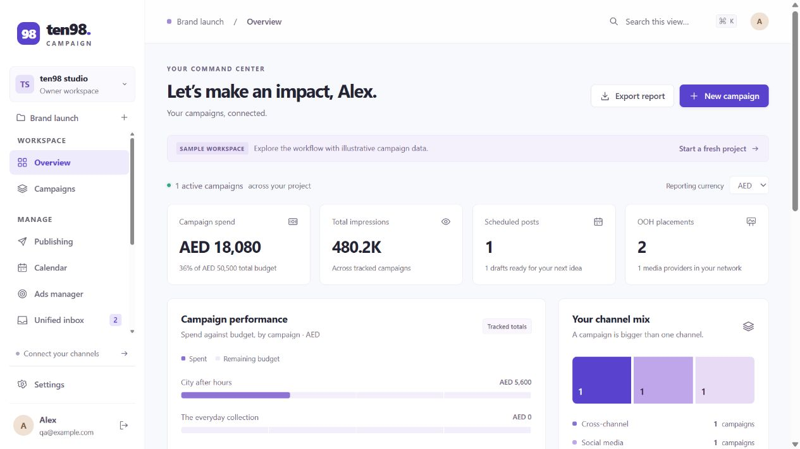

# ten98 Campaign

An open-source, self-hosted campaign manager for social publishing, online advertising, messaging, out-of-home media, digital assets, and campaign planning. Workspaces contain projects; workspace membership controls access to every project in that workspace.

Version 0.2 uses Zernio for social, advertising, inbox, and analytics; Google Drive for the DAM; Google Calendar for shared planning; Broadsign for OOH proposals and bookings; Google Maps for locations; and OpenRouter for an optional campaign assistant. The application is [MIT licensed](LICENSE). Provider accounts, API access, media spending, and model usage remain subject to their providers' terms and charges.



## Run locally

Requires **Node.js 22.14+** and npm. The Docker image uses Node 24. SQLite is included with Node; some versions print an experimental SQLite warning.

```sh
npm ci
cp .env.example .env
npm run build
npm start
```

Open [http://127.0.0.1:3018](http://127.0.0.1:3018) and create the first owner account. This account is also the instance operator. Public signup then closes. Optional sample records are marked and excluded from live publishing and calendar-plan sync.

For development, run `npm run dev` and open [http://127.0.0.1:5178](http://127.0.0.1:5178). The runner starts the API and Vite with the matching browser origin. Configure integrations in `.env` and restart after changes. Keep `.env` and `data/` private.

## Included workflows

| Area | Available behavior |
| --- | --- |
| Campaigns | Workspace/project organization, roles, dates, budgets, separate currency totals, local results, and CSV export. |
| Social | Multi-channel drafts, assets, planning calendar, explicit publish/schedule submission, and provider status reconciliation. Zernio executes submitted schedules. |
| Advertising | Campaign/ad-group/ad reporting; supported status, budget, targeting, and creative changes; paused ad creation and eligible post boosting. |
| Inbox | Project-scoped direct messages, replies and archiving through Zernio, plus signed durable webhook ingestion. |
| OOH | Local provider/booking ledger, verified Broadsign inventory, proposals, availability, explicit booking submission, delivery totals, and mapped locations. |
| DAM | Asset links, tags, approvals, Google Drive metadata sync, and Shared Drive uploads. Originals remain in Drive. |
| Planning | Local publishing calendar and optional Google Calendar events and campaign-plan publishing. |
| Analytics | Campaign totals and Zernio social dashboards, daily metrics, and top posts; missing live values remain unknown. |
| Assistant | OpenRouter tool calls over the current project, optional inbox snippets, usage reporting, and draft suggestions saved only after review. |

## Zernio: social and advertising

Set `ZERNIO_API_KEY`. Create a Zernio profile for each project, then have an **instance operator who also administers that workspace** map its profile ID in Settings. Workspace ownership alone cannot assign shared provider credentials. Connect supported channels in the app; use Zernio's dashboard for provider-specific credential flows, including OpenAI Ads. Load connected accounts before publishing or creating ads.

The ad editor supports these formats, subject to the connected account's permissions and Zernio availability:

| Network | Creation formats |
| --- | --- |
| Meta | Image, video, carousel; supported conversion and lead-form objectives. |
| Google | Search, Display, Performance Max, and Demand Gen image/video/carousel assets. |
| TikTok | Video. |
| LinkedIn | Image and video; supported lead forms. |
| Pinterest | Image. |
| X | Website card. |
| Reddit | Image, video, carousel, and text. |
| OpenAI / ChatGPT | Sponsored card with supported bidding and objectives. |

New ads and boosts start **paused**. Budgets use the advertising account's currency and daily budget rules. Review conversion tracking, targeting, creative approval, and provider-side settings before activation. Supported campaign/ad-group budgets, ad edits, targeting lookup, and status controls are available through Ads manager; unsupported combinations return an error. Lifetime budgets, niche creative types, custom-audience management, conversion installation, and comprehensive bulk editing remain provider-dashboard workflows. The Zernio API supports more options than this editor exposes. [Zernio ad creation contract](https://docs.zernio.com/ad-campaigns/create-standalone-ad).

Every provider action checks project/account scope. Mutating requests use persistent idempotency records; an uncertain outcome blocks duplicate automatic submissions, including attempts with a fresh key. Reconcile those operations in the provider before proceeding; there is no general integration recovery UI yet.

Pinterest, LinkedIn, and X campaign status changes currently show provider acknowledgement without a live status readback; other supported networks return a verified status when available.

Social media and ad creatives need public HTTPS delivery URLs. Private Drive previews remain DAM references and cannot be submitted as publishable binaries. Sample posts and assets cannot be sent to live publishing providers.

## Zernio inbox webhooks

Set a strong `ZERNIO_WEBHOOK_SECRET`, then register **`https://your-app.example/api/webhooks/zernio`** in Zernio using the same secret. The endpoint must be publicly reachable over HTTPS. Configure its profile filter to match this installation's projects.

Subscribe to the needed inbox events: `message.received`, `message.sent`, `message.edited`, `message.deleted`, `message.delivered`, `message.read`, `message.played`, `message.failed`, `conversation.started`, and `conversation.control_changed`. Post lifecycle and per-platform terminal events also update existing linked posts. Platform support varies. [Zernio delivery, signatures, and subscriptions](https://docs.zernio.com/webhooks); [inbox payload contracts](https://docs.zernio.com/webhooks/inbox).

The receiver verifies the raw-body HMAC-SHA256 signature before parsing, accepts up to 1 MB, persists events before acknowledgement, and deduplicates by the stable event UUID. A local worker processes pending events and resumes after restart. Use **one unique Zernio profile per project**: unmapped or ambiguous profile mappings stay pending instead of routing messages to another project. Routing uses provider profile IDs, never arbitrary event metadata. Delayed legitimate deliveries remain valid; replay protection comes from durable deduplication.

Cached conversations expose the latest 500 webhook messages; normalized message history and bounded event payloads remain in the private database. REST refresh reads up to 100 messages per page. Webhooks do not backfill earlier history. Reactions, comments, reviews, test deliveries, and other unsupported events are acknowledged without creating live DMs. Attachment references are retained; expiring CDN links and authenticated WhatsApp media are not downloaded into permanent storage. The inbox currently focuses on direct messaging, including Messenger through Zernio.

## Google Drive DAM

Enable the Drive API, set `GOOGLE_SERVICE_ACCOUNT_EMAIL` and `GOOGLE_PRIVATE_KEY`, and share a folder with that service account. An instance operator with workspace administration maps the folder ID in Settings. Choose **Sync Drive** in the asset library.

Sync stores metadata and original links without making files public. It lists the mapped folder directly, without recursion, up to 2,000 files across 20 pages; an incomplete search does not produce a partial sync. Uploads require a folder in a **Google Shared Drive** and accept JPG, PNG, WebP, GIF, MP4, PDF, or text up to 5 MB. Tokens stay server-side. [Drive API](https://developers.google.com/workspace/drive/api/guides/about-sdk); [service-account authorization](https://developers.google.com/identity/protocols/oauth2/service-account).

## Google Calendar

Enable the Calendar API for the same service account. Share a dedicated calendar with that account and grant event editing permission. In Calendar, an instance operator with workspace administration maps its calendar ID; a calendar can belong to only one project.

**Load Google events** reads the selected range. Editors can create events and change or delete events managed by that project; unrelated calendar events are read-only. **Publish campaign plan to Google** explicitly creates or updates dated campaigns, OOH placements, and scheduled posts with stable IDs. Sample records are excluded. It does not delete stale plan events or publish social posts.

The plan is capped at 100 dated records, list reads at 2,500 events, and explicit date windows at 366 days. All-day event end dates are exclusive; inclusive campaign/placement end dates are converted accordingly. Scheduled posts occupy 30-minute planning slots. Writes suppress attendee notifications. [Calendar event API](https://developers.google.com/workspace/calendar/api/guides/create-events).

## Broadsign OOH

Set `BROADSIGN_API_KEY` and start with `BROADSIGN_ENVIRONMENT=sandbox`; use `production` only with the corresponding production account. Optionally pin its domain with `BROADSIGN_DOMAIN_ID`. The app uses fixed Broadsign endpoints and API-key authentication. In the OOH provider panel, an instance operator with workspace administration approves the verified domain, client, and an explicit allowlist of up to 100 screen/face IDs. Inventory cannot overlap another project in the same domain/environment. Existing bookings lock changes to that mapping. Sandbox and production resource IDs differ. [Broadsign API keys](https://docs.broadsign.com/broadsign-platform/en/Documentation_Settings/settings-api-keys.html); [campaign API workflow](https://docs.broadsign.com/broadsign-platform/en/Documentation_Gteed_Campaigns/g-c-new-campaign-rest.html).

Sync the approved inventory, select locations, enter the provider quote, and save a proposal. Availability is checked separately. Booking submission requires the user's explicit paid-booking confirmation and rechecks the provider's domain, client, line items, screens, dates, and quote. The provider reports final booking status. Ambiguous or partly created operations require reconciliation in Broadsign.

The integration currently creates one frequency line item for the selected digital screens or static faces: **one play per loop, every day, full-day scheduling**, with a booking range of at most 366 days. Refreshing delivery reads aggregate impressions/plays and updates project placements. The provider quote belongs to the whole line item; per-screen cost and currency are kept unknown rather than allocated or inferred. Creative trafficking, raw proof-of-play logs, cancellation, dayparting, and broader OOH marketplace/payment integrations remain outside this integration. Local manual bookings and proof links are also available.

## Google Maps

Enable Maps JavaScript API and billing in your Google Cloud project, then configure `GOOGLE_MAPS_BROWSER_API_KEY`. This key is **public in the browser by design**: restrict it to that API and your exact allowed HTTP referrers, including development origins only when needed. Set your own production `GOOGLE_MAPS_MAP_ID`; the fallback `DEMO_MAP_ID` is for evaluation. [Key restrictions](https://developers.google.com/maps/api-security-best-practices); [map IDs](https://developers.google.com/maps/documentation/javascript/map-ids/mapid-over).

The map shows provider-supplied coordinates and team-entered placement coordinates. Enter both latitude and longitude; no automatic geocoding is performed. Provider locations are labeled separately. When Maps is enabled, the app uses a per-response script nonce and Google-compatible content/referrer policies. The server-side service-account private key is never returned as map configuration.

## OpenRouter campaign assistant

Set `OPENROUTER_API_KEY` and a tool-capable `OPENROUTER_MODEL`. The assistant runs orchestration and project tools on this application server; **model inference runs remotely through OpenRouter**. Submitted prompts and requested project context leave the server. Inbox snippets are shared only when the user opts in for that request. [OpenRouter tool calling](https://openrouter.ai/docs/guides/features/tool-calling).

The assistant can read scoped campaign/post/placement/asset data and propose local drafts. It cannot publish, send replies, activate ads, or book inventory. Users review each suggestion before saving it; saved suggestions are validated through the normal record rules. The default request loop allows four model calls and 2,048 completion tokens per call, configurable through `OPENROUTER_MAX_STEPS` (maximum eight) and `OPENROUTER_MAX_TOKENS` (maximum 8,192).

History records the provider-reported token usage and cost; unavailable usage remains unknown. A failed connection can leave a billable outcome uncertain, so duplicate attempts are blocked until the user reviews the request in OpenRouter and marks it reviewed. [Usage accounting](https://openrouter.ai/docs/cookbook/administration/usage-accounting). Model quality and tool support depend on the chosen model.

## Authentication and team access

Roles are owner, admin, editor, and viewer. Workspace owners/admins manage existing members; instance operators separately control shared integration mappings. Local authentication uses password hashes, hashed sessions, and login rate limits.

For OIDC, configure `OIDC_ISSUER`, `OIDC_CLIENT_ID`, `OIDC_CLIENT_SECRET`, and the exact callback `APP_URL/api/auth/oidc/callback`. Issuers require HTTPS. `OIDC_ALLOWED_EMAILS` allows new accounts with verified email addresses; those accounts receive separate workspaces until invited to a team. Identities are keyed by issuer and subject. Matching emails do not automatically link local and OIDC accounts. The code uses authorization code flow, PKCE, state, nonce, and token validation through [openid-client](https://github.com/panva/openid-client).

Provision a local account using the operator CLI, supplying one JSON object on standard input:

```sh
node --env-file-if-exists=.env server/cli.mjs create-user
```

Input: `{"name":"Team member","email":"member@example.com","password":"a unique password of at least 12 characters"}`. Use a secure terminal or password-manager pipe, keeping real passwords out of shell arguments and history. The new account has no workspace membership until invited. The `grant-operator` command accepts `{"email":"operator@example.com"}` on standard input and grants mapping authority without workspace membership.

## Deployment and operations

For Docker, configure `.env`, run `docker compose up --build -d`, and complete first-run setup locally. Compose binds port 3018 to loopback. Place the service behind an HTTPS reverse proxy and set `APP_URL` to the exact public origin before exposure; HTTPS enables secure session cookies. Forward the webhook route without changing its request bytes. The health endpoint is `GET /api/health`.

Run one application process with the current SQLite store. Back up the entire private data directory, including its generated session secret, using a consistent SQLite backup or stopping the app before copying files. Event payloads, messages, AI history, and integration operations are stored there; retention and deletion policies need operator management. Provider secrets belong in server environment configuration. Startup, local status checks, and health checks make no paid provider requests; enabling a Google map loads Google's browser service when the map view opens.

## Checks and current limits

```sh
npm run build
npm test
```

CI builds and runs native Node regression tests against temporary databases/HTTP servers and mocked provider responses. Coverage includes authentication, project isolation, provider scoping, request validation, signed webhook replay/order/restart behavior, ad formats, Broadsign booking contracts, Google Calendar/Drive, and agent review/usage flows. **CI makes no paid API calls.** Successful tests verify application behavior and mocked contracts; they do not establish live acceptance by Zernio, an ad account, Google, Broadsign, OpenRouter, or an identity provider. Verify each integration with your own credentials before production use.

This release does not claim complete Buffer/Hootsuite/Mixpost parity. Large inbox/ad views stop at explicit pagination limits rather than claiming completeness. MFA, password recovery, general approval workflows, automatic retention, high-availability storage, and full provider recovery tooling remain future work.

See [CONTRIBUTING.md](CONTRIBUTING.md), [SECURITY.md](SECURITY.md), and [THIRD_PARTY_NOTICES.md](THIRD_PARTY_NOTICES.md). The Zernio [ads dashboard](https://github.com/zernio-dev/ads-dashboard) and [unified inbox](https://github.com/zernio-dev/unified-inbox) informed the workflows; they are referenced rather than embedded as separate applications.
