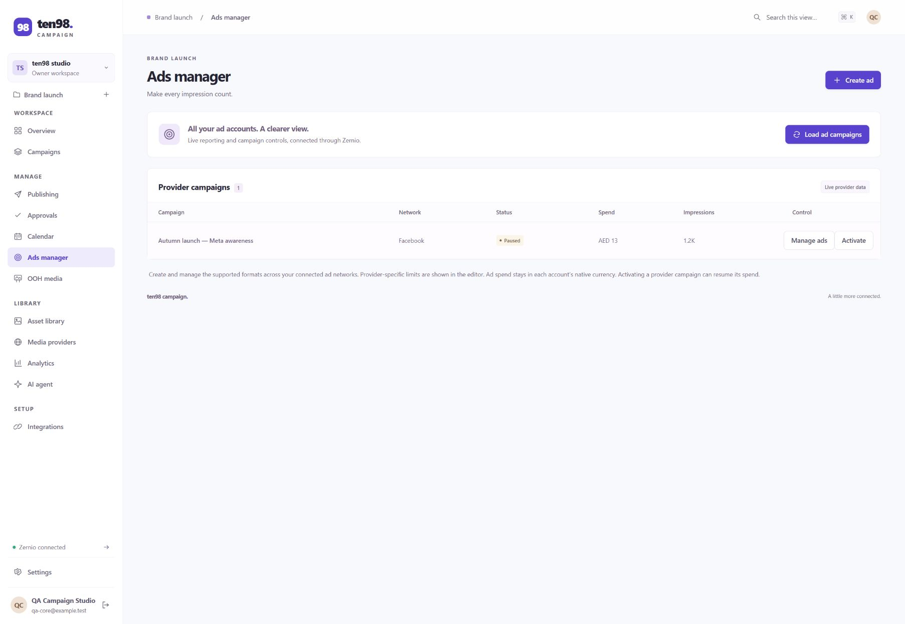

# ten98 Campaign

Common architecture and server mechanisms are maintained in [ten98-code-system](https://github.com/Ten98-IO-Company/ten98-code-system). `npm run check:architecture` validates the installed shared contract; the normal test and build commands include it.

An open-source, self-hosted campaign manager for social publishing, online advertising, out-of-home media, transactional email, SMS, WhatsApp, digital assets, and campaign planning. Workspaces contain projects; workspace membership controls access to every project in that workspace.

Version 0.9.0 includes social publishing, advertising, OOH, Drive DAM, direct campaigns, a **Unified inbox** with two-way Twilio SMS and approved WhatsApp template replies, and campaign short links, QR codes and website tracking. Google Calendar supports shared planning; Broadsign handles OOH proposals/bookings; Google Maps shows locations; OpenRouter prepares optional content drafts. Cloudflare sends transactional email with an optional external reply address; WhatsApp broadcasts and conversations use Zernio. Voice calling and a receiving email inbox are excluded. The application is [MIT licensed](LICENSE). Provider accounts, API access, message charges, media spending, and model usage remain subject to their providers' terms and charges.



The Zernio expansion includes hosted delivery uploads with recovery, scoped inbox attachment retrieval, explicit typing and reviewed stored-conversation removal. Separate account captions/media/options/times, fixed group recipients, queues, recurring posts, destination management, reports, lead forms, Google conversion settings, contacts/custom fields and paid-ad notifications remain available. Snapchat is blocked by provider approval; existing drafts remain available. Full Zernio parity and remaining manual browser/live-account acceptance are tracked in [verification and remaining scope](docs/verification.md).

Pages, primary sections and project selection have shareable URLs and browser history. Unsaved editor dialogs use an inline discard review; ad-detail refreshes also protect unfinished creative and sibling campaign/ad-set forms. Accepted Microsoft updates with unavailable readback stay uncertain and cannot be automatically repeated.

## Run locally

Requires **Node.js 22.14+** and npm. The Docker image uses Node 24. SQLite is included with Node; some versions print an experimental SQLite warning.

```sh
npm ci
cp .env.example .env
npm run build
npm start
```

Open [http://127.0.0.1:3018](http://127.0.0.1:3018) and create the first owner account using the host-held setup token. Before setup, the server generates `DATA_DIR/bootstrap-token` with private file permissions; read it locally (for Docker: `docker compose exec campaign cat /app/data/bootstrap-token`). Alternatively set `BOOTSTRAP_TOKEN` to 32–512 random non-whitespace characters. Keep the token private and out of URLs, logs and source control. Setup remains claimed after account deletion; existing installations are backfilled as claimed and continue to sign in normally. Failed transactions retain the unclaimed state so the same token can retry. This account is also the instance operator. Public signup then closes. Optional sample records are marked and excluded from live publishing and calendar-plan sync. Owners/admins can remove all sample data from Project settings; cleanup refuses when your own work still refers to a sample record. Assigned campaigns, assets, and media providers must be unassigned before deletion so drafts and bookings keep valid references.

Signed-in accounts without project access can refresh after an invitation, create their own workspace, or manage their account from the starting screen.

Choose **Settings → Your account → Appearance** to switch between **System**, **Light** and **Dark**. System follows your device preference. The choice is saved in this browser; when browser storage is unavailable, it applies only until the page is reloaded.

For development, run `npm run dev` and open [http://127.0.0.1:5178](http://127.0.0.1:5178). The runner starts the API and Vite with the matching browser origin. Configure provider credentials and project connections in **Integrations**, or use `.env` as an operator-managed credential fallback. Calendar, advertising and OOH pages link to this single setup location; their campaign, event and booking controls remain in the feature. Google Drive and Calendar share one credential editor, with separate connection tests. Changes saved in the app apply immediately; Google Maps browser changes require a page reload. Editing `.env` requires restarting the server. Keep `.env` and `data/` private.

## Included workflows

Full Zernio coverage is the expansion target. The [detailed feature breakdown](docs/zernio-feature-plan.md) separates implemented workflows from partial, missing and provider-restricted capabilities, with platform matrices and the pinned API inventory. It is an implementation backlog; the table below describes this release.

| Area | Available behavior |
| --- | --- |
| Campaigns | Workspace/project organization, roles, dates, budgets, separate currency totals, local results, and CSV export. |
| Social | Per-platform and per-account captions, media, options and fixed times; explicit group recipients; previews and restriction checks; content approvals; explicit publish/schedule submission; status reconciliation, rescheduling, cancellation, eligible retries, and supported published-copy changes. Zernio executes submitted schedules. |
| Direct campaigns | Cloudflare transactional email, Twilio SMS, and Zernio approved WhatsApp templates; consent-aware contacts; CSV import preview and deduplication; disposable/role/typo flags, DNS mail-route checks, suppression, signed unsubscribe/opt-out handling, scheduling and delivery receipts. |
| Unified inbox | Scoped Zernio messages, comments and reviews; automatic Messenger contacts without inferred campaign consent; durable Twilio SMS history and explicit replies through the original sender. |
| Links & tracking | Project/campaign short links, optional branded domain, SVG QR downloads, ordinary/QR-tagged visit totals, and cookie-free website pageview/event aggregates. |
| Advertising | Verified Meta/LinkedIn lead forms, Google conversion actions/goals, scoped paid-ad update history; campaign/ad-group/ad reporting; supported status, budget, targeting, and creative changes; paused ad creation and eligible post boosting. |
| OOH | Local provider/booking ledger, verified Broadsign inventory, proposals, availability, explicit booking/cancellation, delivery totals, and mapped locations. |
| DAM | Asset links, temporary Zernio delivery uploads with progress/recovery/cancellation, tags, approvals, Google Drive metadata sync, and Shared Drive uploads. Replacing delivery media preserves Drive originals and resets approval. |
| Planning | Local publishing calendar and optional Google Calendar events and campaign-plan publishing. |
| Analytics | Campaign totals and Zernio social dashboards, daily metrics, and top posts; missing live values remain unknown. |
| Draft content | OpenRouter tool calls over the current project's campaigns, posts, placements and assets, usage reporting, and draft suggestions saved only after review. |
| Team and account | Workspace invitations, roles, local/OIDC sign-in, account details, local password changes, and session revocation. |
| Integrations | Encrypted saved configuration, explicit read-only connection tests, project mappings, and audited handling of uncertain provider outcomes. |

## Integration settings

The **Integrations** page configures Zernio, OpenRouter, Google Shopping, Microsoft Advertising, Google Drive, Google Calendar, Google Maps, Broadsign, Cloudflare transactional email, and Twilio SMS. Expand a provider’s **Connection settings** to configure or test it; **Setup instructions** contains the detailed requirements. Only an **instance operator** can read or change installation-wide credentials and run connection tests. Operators also need workspace owner/admin access to change a project's Zernio profile, Drive folder, or shared calendar mapping. Workspace ownership alone does not grant installation credentials access.

Saved fields override their server environment values. A blank secret field keeps its current credential; **Clear this credential** explicitly disables that field, including environment fallback. **Use deployment settings** removes that provider's saved overrides. Drive and Calendar share one service account, so saving, clearing, or resetting its credentials affects both. The Integrations UI calls the installation operator **App administrator**; workspace ownership alone does not grant this access. Credentials are not returned in settings responses; the Google Maps key is separately available to authorized project members because Google's browser service requires it.

Settings are encrypted in SQLite using AES-256-GCM and a key derived from the instance session secret. Back up the database **with the matching `SESSION_SECRET` or generated `data/session-secret`**. Replacing that secret without preserving its match makes saved integration settings unreadable. Protect the complete data directory, including backups.

**Test connection** runs only when requested. Zernio checks accessible profiles, OpenRouter checks key access without generating a model completion, Drive checks the saved folder, Calendar checks the saved calendar's read access, and Broadsign checks its account/domain. These checks do not publish, send, upload, book, change events, or verify every write permission. Maps performs a browser map-rendering check after any required page reload; configuration alone is not reported as a verified map connection. Save project mapping edits before testing.

## Email, SMS and WhatsApp campaigns

Open **Direct campaigns** to import or maintain project contacts, record channel-specific consent, and create drafts. Preview recipients and personalized content before an explicitly confirmed send or schedule. Email/SMS use `{{name}}`, `{{email}}`, `{{phone}}`, and `{{company}}`. WhatsApp requires an approved template/language; text values, public image/video/document headers, static buttons and supported URL-suffix buttons are available.

Cloudflare permits **transactional email only**: receipts, expected reminders and service notices. Marketing newsletters are unavailable through this connection. Configure Twilio's sender or Messaging Service for SMS and the project's Zernio WhatsApp Business account for broadcasts. Sending requires a publicly reachable HTTPS `APP_URL` so recipient preferences and delivery callbacks work. Connection tests send no email or SMS.

Set Cloudflare's optional **Reply-to address** (`CLOUDFLARE_EMAIL_REPLY_TO_ADDRESS`) to an address your team receives externally. For example, configure Cloudflare Email Routing to forward that address to a verified group or mailbox. The app sets the outgoing reply header; it does not provision forwarding or receive email. The [direct campaign guide](docs/direct-campaigns.md) covers setup.

Contact cleanup rejects invalid syntax, deduplicates canonical destinations, flags common disposable/role/typo addresses, and checks MX/A/AAAA/null-MX records on request. DNS and heuristics cannot prove that a mailbox exists. Confirmed hard bounces, provider suppressions, manual suppression, email unsubscribe and SMS STOP prevent future sends. Suppression survives deletion/reimport and cannot be cleared by importing another opt-in. Verified SMS opt-outs also retain an installation-wide phone hash, protecting existing and future projects and inbox replies.

The persistent local queue sends one email/SMS recipient per second, up to 500 eligible recipients per campaign; Zernio paces WhatsApp broadcasts. Run one app process with SQLite. Uncertain sends stop for review and are not automatically replayed after restart. Cloudflare queued mail has no per-message delivery lookup; send receipts and suppression refresh are shown without invented open/click metrics. See the [setup, hygiene and delivery guide](docs/direct-campaigns.md). Contact/campaign interface ideas are inspired by [listmonk](https://listmonk.app/); its source is not incorporated.

Use **Open replies** from an SMS or WhatsApp campaign to enter its inbox view. Twilio SMS history is stored locally after signed callback verification and unambiguous outbound-ledger attribution. WhatsApp opens the existing Zernio account/feed; select the conversation before replying, since a participant identity may differ from a campaign phone number. Inbox replies do not grant campaign consent.

## Short links, QR codes and website tracking

Open **Links & tracking** to create a public HTTPS destination, associate it with a project campaign, and download its SVG QR code. The caption and email/SMS editors can explicitly shorten text links before saving; media delivery URLs are unchanged. Saved destinations and short-link domains are immutable; archive a link to stop its redirects. A branded origin requires instance-operator and workspace-administrator access plus your own DNS/TLS reverse-proxy setup. The read-only domain challenge confirms a request reached this instance, not independently verified domain ownership.

Website tracking uses an explicit origin allowlist and public project snippet. It records UTC daily pageviews and named events without visitor IDs, cookies, IP addresses or user agents, strips query strings/fragments/referrers, and respects Do Not Track and Global Privacy Control. Ordinary and QR-tagged visits count requests, not unique people or verified conversions. See [tracking setup, retention and limits](docs/tracking.md).

## Zernio: social and advertising

Configure Zernio in **Integrations** or set `ZERNIO_API_KEY`. Create a Zernio profile for each project, then have an **instance operator who also administers that workspace** map its profile ID. Connect supported channels in the app; use Zernio's dashboard for provider-specific credential flows or the app's OpenAI Ads connection form. Load connected accounts before publishing or creating ads.

The ad editor supports these formats, subject to the connected account's permissions and Zernio availability:

| Network | Creation formats |
| --- | --- |
| Meta | Image, video, carousel; supported conversion and lead-form objectives. |
| Google | Search, Display, Performance Max, and Demand Gen image/video/carousel assets. |
| TikTok | Video. |
| LinkedIn | Image and video; supported lead forms. |
| Pinterest | Image. |
| X | Website card. |
| Reddit | Image, video, carousel, and text. |
| OpenAI / ChatGPT | Sponsored card with supported bidding and objectives. |

New ads and boosts start **paused**. Budgets use the advertising account's currency; OpenAI supports daily and lifetime allocations. Review conversion tracking, targeting, creative approval, and provider-side settings before activation. Ads manager supports bounded campaign/ad-group budgets, ad edits, targeting lookup and status controls. Meta daily ad-set budget changes in AED/USD require a fresh before/after review and explicit confirmation, followed by independent live readback; lifetime and campaign-owned allocations are excluded from that control. Google and ChatGPT budgets belong in the campaign editor. Unsupported combinations return an error. Niche creative types, custom-audience management, conversion installation, and comprehensive bulk editing remain provider-dashboard workflows. The Zernio API supports more options than this editor exposes. [Zernio ad creation contract](https://docs.zernio.com/ad-campaigns/create-standalone-ad).

Google paid-search tools include keywords, campaign negatives, search terms, Keyword Planner, targeting and bidding. Native Google Standard Shopping creation and Microsoft Search campaigns have separate credentials and verified project mappings. Copilot eligibility comes through Microsoft; supported Google campaigns can qualify for Google's AI search inventory under provider rules. Standard Google Video creation is unavailable in its API; existing Video reporting and Zernio Demand Gen video creation are supported. Organic Search Console/SEO stays in ten98 Discover. See [advertising setup and limits](docs/advertising.md).

Every provider action checks project/account scope. Mutating requests use persistent idempotency records; uncertain outcomes block duplicate submissions, including attempts with a fresh key. Use the provider-operation review panel in **Settings** to reconcile an interrupted action after checking the actual provider outcome. See deployment and operations below.

Pinterest, LinkedIn, and X campaign status changes currently show provider acknowledgement without a live status readback; other supported networks return a verified status when available.

Social media and ad creatives need public HTTPS delivery URLs. Private Drive previews remain DAM references and cannot be submitted as publishable binaries. Sample posts and assets cannot be sent to live publishing providers.

## Per-platform social composition

Create a shared caption and media set, choose destinations, then open each platform's tab to customise its copy. Each platform can use its own caption, a different approved DAM asset, a separate ordered set of public media URLs, or no media. Leaving an override off inherits the shared value; an explicitly empty caption or media set remains empty. Connected-account selections are preserved when drafts are reopened. Multiple accounts on the same platform share that platform's customisation.

The composer supports Instagram, Facebook, LinkedIn, TikTok, X, YouTube, Pinterest, Threads, Bluesky, Reddit, Google Business Profile, Telegram, Discord and Slack, subject to Zernio/account access. Snapchat configuration exists in the model, but [Zernio currently rejects all new Snapchat connections](https://docs.zernio.com/platforms/snapchat); it is unavailable for normal onboarding. WhatsApp uses the dedicated direct-campaign and inbox workflows.

Publishing options follow the selected platform: examples include Instagram Stories, Reel covers, collaborators and disclosures; Facebook Stories/Reels and carousel cards; TikTok privacy, interactions, commercial disclosure and posting consent; YouTube title, visibility and audience settings; Pinterest board, title and destination; X/Threads threads, X reply settings and polls; LinkedIn documents, audience and polls; and Reddit community/title settings. Advanced structured options are validated against the supported Zernio contract. TikTok creator information supplies current privacy choices, interaction permissions, posting availability and video-duration limits.

Each tab shows its effective caption/media preview and a character counter, including weighted X text and Bluesky graphemes. Previews show the selected content and attachment order; actual platform cropping, link rendering and controls vary by device. Local checks cover caption limits, required options/media, supported formats, attachment counts, incompatible combinations, and supplied size, MIME type, dimensions and video duration. Use **Check dimensions** or **Check file with Zernio** to inspect media. Unknown metadata is reported for verification instead of treated as a successful file check.

Incomplete drafts can be saved locally. **Check with Zernio** explicitly checks the current draft without publishing it. Publishing, scheduling, scheduled updates, retries and supported published-copy edits run the applicable local restrictions and mandatory Zernio preflight against the exact outgoing copy; an unavailable, invalid or rejected provider check blocks the write. TikTok submissions also check creator permissions and explicit consent. Account access, delivered-file encoding and changing platform policies still require live provider acceptance with your configured credentials.

A planned time is entered in your local timezone and submitted as a UTC instant. Saving a local draft does not submit it: choose **Publish** or **Schedule** from Publishing to send it to Zernio. Changing a provider post's shared time applies the new time to every destination; an unchanged shared time preserves distinct account schedules. Caption, media and option copies remain intact unless edited; replacing externally divergent copies on multiple accounts of one platform requires explicit confirmation.

## Social post lifecycle and approvals

Submitted posts have provider controls in Publishing. Unpublished provider drafts and schedules can be updated or rescheduled; eligible unpublished copies can be cancelled with explicit confirmation. Failed and partially published posts can retry their failed account copies after a fresh provider status check. Preflight checks only the failed destinations; published and cancelled copies remain unchanged. A required approval must still match the complete current post. Malformed provider preview fields and unsupported publishing options are rejected before import; manage unsupported options in the native provider dashboard.

| Published-copy action | Supported platforms, subject to Zernio and account permissions |
| --- | --- |
| Edit text | X, Discord, Facebook, Reddit, LinkedIn, Telegram, Pinterest, Google Business Profile, YouTube, Slack. |
| Unpublish a selected copy | Threads, Facebook, X, LinkedIn, YouTube, Pinterest, Reddit, Bluesky, Google Business Profile, Telegram. |

Other provider changes remain in the native dashboard. Confirmations distinguish deleting an unpublished provider record from permanently removing a published copy.

**Approvals** has an optional project policy, disabled by default. Owners/admins can require review; editors request it, and owners/admins approve or request changes with an audited actor, time, and note. Review covers the shared content and every platform's effective caption, media and options, selected platforms/accounts, campaign/asset references, and schedule. Asset delivery/original URLs, approval state, type, and available Drive file version/checksum metadata are included for all shared and platform-specific DAM assets. Relevant changes invalidate approval; cosmetic asset names and tags do not. Referenced assets must also be approved.

Approval never publishes automatically. With the policy enabled, publishing and retries need current approval, while changes to submitted post content are restricted to owners/admins. Editors retain explicitly confirmed stop/removal controls. A provider post with every copy confirmed failed can receive a fresh review after its latest provider content is reconciled; partially live posts cannot use that path.

## Unified inbox, comments and reviews

Open **Unified inbox**, choose Messages, Comments or Reviews, select a connected account, then load its feed. Supported actions follow each platform's permissions: private replies and attachments, mark read/archive, public comment threads/replies/hide/like/delete/YouTube moderation, and review replies. Google Business supports replacing or removing the owner reply; a version check prevents silently overwriting a reply changed elsewhere. For an existing WhatsApp conversation, expand **Reply buttons (optional)** to send text with one to three different button labels inside the customer’s 24-hour reply window. Review the exact message and buttons before sending. An uncertain send retains its original action; **Check reply outcome** only reads a recorded receipt and cannot send a new message.

The **SMS replies** tab reads local Twilio conversations and delivery updates. Configure the project-specific incoming-message webhook displayed there. Replies are explicit, use the original sender, respect suppression, and retain durable receipts so uncertain submissions cannot be silently resent. Ambiguous shared-number messages remain unattributed instead of leaking into another project. See [inbox setup and limitations](docs/inbox.md).

Verified incoming Facebook Messenger messages create contacts under **Direct campaigns → Contacts**. Identity is scoped to project, page account and participant ID. Signed incoming webhooks and opening verified incoming history both link the same person; names never merge unrelated people. New contacts have no inferred email, phone or email/SMS/WhatsApp campaign permission. See the [inbox setup and limitations](docs/inbox.md).

## Zernio publishing and inbox webhooks

Set a strong `ZERNIO_WEBHOOK_SECRET`, then register **`https://your-app.example/api/webhooks/zernio`** in Zernio using the same secret. The endpoint must be publicly reachable over HTTPS. Configure its profile filter to match this installation's projects.

Subscribe to post lifecycle events: `post.scheduled`, `post.published`, `post.failed`, `post.partial`, `post.cancelled`, `post.recycled`, `post.platform.published`, `post.platform.failed`, `post.platform.deleted`, and `post.tiktok.url_resolved`. Events update status evidence for existing linked posts; they do not import unrelated provider captions, media or accounts. Platform support varies. [Zernio delivery, signatures, and subscriptions](https://docs.zernio.com/webhooks).

The receiver verifies the raw-body HMAC-SHA256 signature before parsing, accepts up to 1 MB, persists events before acknowledgement, and deduplicates by the stable event UUID. A local worker processes pending events and resumes after restart. Use **one unique Zernio profile per project**: unmapped or ambiguous profile mappings stay pending instead of updating another project. Routing uses provider profile IDs, never arbitrary event metadata. Delayed legitimate deliveries remain valid; replay protection comes from durable deduplication. Out-of-order events cannot overwrite a newer post status.

Subscribe to `message.received`, other relevant `message.*`/`conversation.*` events, `comment.received`, `review.new` and `review.updated` for inbox updates. Incoming Messenger contact creation requires a verified incoming message, not a conversation-start event. New inbox webhook payloads retain only routing/identity metadata; message, comment and review bodies are fetched from the provider on demand. Local update polling makes no paid provider calls; new relevant events refresh an already loaded feed. Pre-connect Messenger history does not emit new-message webhooks, so opening verified incoming history also creates contacts. Unknown/test events remain metadata-only and ignored. Legacy private inbox tables are retained for operator-managed retention and remain outside generic app state and assistant access.

## Google Drive DAM

Enable the Drive API, configure the service account in **Integrations** (or set `GOOGLE_SERVICE_ACCOUNT_EMAIL` and `GOOGLE_PRIVATE_KEY`), and share a folder with it. An instance operator with workspace administration maps the folder ID. Choose **Sync Drive** in the asset library.

Sync stores metadata and original links without making files public. It lists the mapped folder directly, without recursion, up to 2,000 files across 20 pages; an incomplete search does not produce a partial sync. Uploads require a folder in a **Google Shared Drive** and accept JPG, PNG, WebP, GIF, MP4, PDF, or text up to 5 MB. Tokens stay server-side. [Drive API](https://developers.google.com/workspace/drive/api/guides/about-sdk); [service-account authorization](https://developers.google.com/identity/protocols/oauth2/service-account).

Imports validate the complete response and save atomically, deduplicating files across pages and concurrent syncs. Image/video dimensions and video duration are retained for publishing checks; unknown metadata stays unknown. Camera/location EXIF data is not requested. Existing delivery URLs, descriptions, tags and unchanged approvals survive sync. GIF assets use GIF restrictions, and the asset description supplies publishing alt text. [Drive file metadata](https://developers.google.com/workspace/drive/api/reference/rest/v3/files).

An asset's optional **public delivery URL** supplies publishable media while preserving its Drive original. **Upload a public delivery file** streams an image, video or PDF through this app to Zernio, up to 5 billion bytes, without exposing storage upload credentials. Uploads save only after URL/size/type verification, with pending approval. Replacing a delivery file preserves its Drive original, tags and description; its measured MIME, size and kind stay separate from original metadata. Temporary library URLs expire after seven days. Submit a scheduled, queued or immediate post before expiry so Zernio retains that post’s copy; saving a draft alone does not retain it. Existing provider-owned media remains usable for its post; new expired URLs are blocked. [Zernio media lifecycle](https://docs.zernio.com/guides/media-uploads). The app does not grant public Drive permissions or host a delivery CDN. When sync detects changed file metadata/checksum, it resets that asset's approval to pending; associated content approval also becomes stale. Keep public media permissions and usage rights under your control.

## Google Calendar

Enable the Calendar API for the same service account. Share a dedicated calendar with that account and grant event editing permission. In Integrations or Calendar, an instance operator with workspace administration maps its calendar ID; a calendar can belong to only one project.

**Load Google events** reads the selected range. Editors can create events and change or delete events managed by that project; unrelated calendar events are read-only. **Publish campaign plan to Google** previews dated campaigns, OOH placements and each account’s scheduled post copy, including exact updates and obsolete app-managed events to remove. Native revisions protect concurrent edits; durable generation records handle Google’s retained deletion tombstones. Manual, foreign and changed events remain visible. Sample records are excluded. Calendar events plan work and never publish social posts.

The plan is capped at 100 dated records, list reads at 2,500 events, and explicit date windows at 366 days. All-day event end dates are exclusive; inclusive campaign/placement end dates are converted accordingly. Scheduled posts occupy 30-minute planning slots. Writes suppress attendee notifications. [Calendar event API](https://developers.google.com/workspace/calendar/api/guides/create-events).

## Broadsign OOH

Configure Broadsign in Integrations or set `BROADSIGN_API_KEY`, starting with `BROADSIGN_ENVIRONMENT=sandbox`; use `production` only with the corresponding production account. Optionally pin its domain with `BROADSIGN_DOMAIN_ID`. The app uses fixed Broadsign endpoints and API-key authentication. In the OOH provider panel, an instance operator with workspace administration approves the verified domain, client, and an explicit allowlist of up to 100 screen/face IDs. Inventory cannot overlap another project in the same domain/environment. Existing bookings lock changes to that mapping. Sandbox and production resource IDs differ. [Broadsign API keys](https://docs.broadsign.com/broadsign-platform/en/Documentation_Settings/settings-api-keys.html); [campaign API workflow](https://docs.broadsign.com/broadsign-platform/en/Documentation_Gteed_Campaigns/g-c-new-campaign-rest.html).

Sync the approved inventory, select locations, enter the provider quote, and save a proposal. Availability is checked separately. Booking submission requires the user's explicit paid-booking confirmation and rechecks the provider's domain, client, line items, screens, dates, and quote. The provider reports final booking status. Ambiguous or partly created operations require reconciliation in Broadsign.

The integration creates one frequency line item for the selected digital screens or static faces: **one play per loop, every day, full-day scheduling**, with a booking range of at most 366 days. Refreshing delivery reads aggregate impressions/plays and updates project placements. The provider quote belongs to the whole line item; per-screen cost and currency are kept unknown rather than allocated or inferred.

Eligible submitted, booked, or live proposals offer an explicitly confirmed cancellation request. The app reads back the provider status: **12 confirms cancelled; 15 means cancellation is still in progress**. Delivery may continue until confirmation. Charges and refunds depend on the media provider's terms; cancellation does not imply either a refund or no charge.

Use the proposal ID and the in-app handoff to [Broadsign Guaranteed Campaigns](https://app.broadsign.com/campaigns) to upload, approve, and schedule creative bundles in its separate creative module. Raw proof-of-play logs require a separate Broadsign Control/POP integration. Dayparting and broader OOH marketplace/payment APIs remain provider workflows. Local manual bookings and proof links are also available.

## Google Maps

Enable Maps JavaScript API and billing in your Google Cloud project, then configure its browser key and map ID in Integrations or through `GOOGLE_MAPS_BROWSER_API_KEY` / `GOOGLE_MAPS_MAP_ID`. This key is **public in the browser by design**: restrict it to that API and your exact allowed HTTP referrers, including development origins only when needed. Use your own production map ID; the fallback `DEMO_MAP_ID` is for evaluation. Reload the page after saving Maps settings, then choose **Test connection** for a real map-rendering check. [Key restrictions](https://developers.google.com/maps/api-security-best-practices); [map IDs](https://developers.google.com/maps/documentation/javascript/map-ids/mapid-over).

The map shows provider-supplied coordinates and team-entered placement coordinates. Enter both latitude and longitude; no automatic geocoding is performed. Provider locations are labeled separately. When Maps is enabled, the app uses a per-response script nonce and Google-compatible content/referrer policies. The server-side service-account private key is never returned as map configuration.

## OpenRouter campaign assistant

Configure OpenRouter in Integrations or set `OPENROUTER_API_KEY` and a tool-capable `OPENROUTER_MODEL`. The assistant runs orchestration and project tools on this application server; **model inference runs remotely through OpenRouter**. Submitted prompts and requested campaign/post/placement/asset context leave the server. Inbox context and its old opt-in field are no longer accepted. [OpenRouter tool calling](https://openrouter.ai/docs/guides/features/tool-calling).

The assistant can read scoped campaign/post/placement/asset data and propose local drafts, including ad creatives. Ad suggestions open the ad builder with supported copy and media; you explicitly select the account and budget before submission. It cannot publish, activate ads, or book inventory. Users review each suggestion before saving it; saved suggestions are validated through the normal record rules. The default request loop allows four model calls and 2,048 completion tokens per call, configurable through `OPENROUTER_MAX_STEPS` (maximum eight) and `OPENROUTER_MAX_TOKENS` (maximum 8,192).

History records the provider-reported token usage and cost; unavailable usage remains unknown. A failed connection can leave a billable outcome uncertain, so duplicate attempts are blocked until the user reviews the request in OpenRouter and marks it reviewed. [Usage accounting](https://openrouter.ai/docs/cookbook/administration/usage-accounting). Model quality and tool support depend on the chosen model.

## Authentication and team access

Roles are owner, admin, editor, and viewer. Workspace owners/admins manage existing members; instance operators separately control shared integration mappings. Local authentication uses password hashes, hashed sessions, and login rate limits. Session and OIDC browser cookies are scoped by configured app origin so separate local instances can coexist. Valid legacy sessions migrate without extending their expiry.

In Settings, owners/admins create **seven-day, single-use invitation links** and copy them to the intended person manually; the app does not send invitation email. Administrators can invite editors/viewers; only owners can grant owner/admin access. A new local member chooses their own password. An existing member must sign in with the matching invited identity; a link cannot replace their password or grant instance-operator authority. Revoked, expired, used, and no-longer-authorized invitations fail closed.

Account settings allow changing a display name, changing a local password after verifying the current password, and signing out other sessions. Local password changes revoke prior sessions and issue a current session. For a forgotten local password, the server operator can use the recovery CLI below; OIDC password recovery and MFA belong to the identity provider.

For OIDC, configure `OIDC_ISSUER`, `OIDC_CLIENT_ID`, `OIDC_CLIENT_SECRET`, and the exact callback `APP_URL/api/auth/oidc/callback`. Issuers require HTTPS. `OIDC_ALLOWED_EMAILS` allows new accounts with verified email addresses; those accounts receive separate workspaces until invited to a team. An invitation can be resumed after the OIDC redirect. Identities are keyed by issuer and subject. Matching emails do not automatically link local and OIDC accounts. The code uses authorization code flow, PKCE, state, nonce, and token validation through [openid-client](https://github.com/panva/openid-client).

Provision a local account using the operator CLI, supplying one JSON object on standard input:

```sh
node --env-file-if-exists=.env server/cli.ts create-user
```

Input: `{"name":"Team member","email":"member@example.com","password":"a unique password of at least 12 characters"}`. Use a secure terminal or password-manager pipe, keeping real passwords out of shell arguments and history. The new account has no workspace membership until invited. The `grant-operator` and `revoke-operator` commands accept `{"email":"operator@example.com"}` on standard input and change instance authority without changing workspace membership. Revocation takes effect for existing sessions immediately. The host can revoke the final operator and later regrant authority to an existing account through this CLI.

Bootstrap and successful host operator commands append user ID, action, source and time to SQLite's `instance_operator_audit` in the same transaction as the grant or revocation. Repeated grant/revoke commands keep the role state idempotent and append another command event, matching Discover. An audit insertion failure fails the command and rolls back the transaction. Existing installations retain their operators and begin with an empty audit table; earlier operator history is unavailable. The source identifies host CLI or bootstrap provenance, not an authenticated human actor. Passwords, setup capabilities and session tokens are not audit fields.

To recover a local password, run `node --env-file-if-exists=.env server/cli.ts reset-password` with `{"email":"member@example.com","password":"a new unique password of at least 12 characters"}` on standard input. It works only for an existing local password account and revokes **all** that account's sessions. It cannot reset an OIDC identity's password. Operator access to the host and private data directory is required.

## Deployment and operations

For Docker, configure `.env`, run `docker compose up --build -d`, and complete first-run setup locally. Compose binds port 3018 to loopback. Place the service behind an HTTPS reverse proxy and set `APP_URL` to the exact public origin before exposure; HTTPS enables secure session cookies. Forward the webhook route without changing its request bytes. The health endpoint is `GET /api/health`.

Run one application process with the current SQLite store. Back up the entire private data directory and matching instance session secret using a consistent SQLite backup or stopping the app before copying files. Post event payloads, SMS bodies and attachment references, legacy private inbox data, contact identities, suppression hashes, short-link destinations, tracking aggregates, AI history, invitations, approval snapshots, encrypted credentials, and integration operations are stored there; retention and deletion policies need operator management. Startup, local status checks, and health checks make no paid provider requests; enabling a Google map loads Google's browser service when the map view opens.

The **Settings** provider-operation panel prioritizes unconfirmed requests alongside recent receipts for an instance operator who also administers the workspace. Check the actual provider dashboard before reviewing an uncertain or interrupted outcome, then record a final decision, note, and optional reference. **Applied** keeps repeating that action blocked. **Not applied** permits a new manual attempt with a new action key; the original key remains closed. Reviews do not replay a request, refund a payment, invent a provider result, or update a campaign automatically. Active requests cannot be reviewed; interrupted requests from the same server session have a safety delay. OpenRouter requests use their separate usage-review controls in the assistant.

## Checks and current limits

See the [verification record](docs/verification.md) for the browser walkthrough and tested scope.

```sh
npm run build
npm test
```

CI builds and runs native Node regression tests against temporary databases/HTTP servers and mocked provider responses. Coverage includes authentication, invitations, session/account controls, encrypted integration settings, project isolation, per-platform publishing and approvals, scoped inbox actions, Messenger contacts, signed SMS attribution/replies/opt-outs, webhook replay/order/restart behavior, short-link redirects, QR generation, tracking privacy/limits, ad formats, Broadsign contracts, Google Calendar/Drive, and agent review/usage flows. **CI makes no paid API calls.** Successful tests verify application behavior and mocked contracts; they do not establish live acceptance by Zernio, Twilio, Cloudflare, an ad account, Google, Broadsign, OpenRouter, or an identity provider. Use the explicit connection tests and verify intended live workflows with your own accounts before production use.

Provider coverage follows the exposed API contracts and account permissions. Rare ad formats, comprehensive bulk/audience tooling, raw OOH proof-of-play, automated retention, and high-availability storage are outside this release. Large views expose pagination or explicit limits. Use the OIDC provider for MFA; local email-based password recovery and automatic invitation delivery are not configured. The application uses one server process with SQLite.

See [CONTRIBUTING.md](CONTRIBUTING.md), [SECURITY.md](SECURITY.md), and [THIRD_PARTY_NOTICES.md](THIRD_PARTY_NOTICES.md). The Zernio [ads dashboard](https://github.com/zernio-dev/ads-dashboard) informed the advertising workflows; it is referenced rather than embedded as a separate application. Historical reference credits remain in the third-party notices.
