# ten98 Campaign v0.8.6 — verification

## Expansion checks and acceptance limits

Verified on 18 October 2026 against the pinned Zernio OpenAPI 1.292.0. All **367 automated checks pass**, with no failures or skipped checks. The production frontend build, production container build and offline non-root container startup pass. The production dependency audit reports **zero vulnerabilities**. No dependency was added. New bookkeeping tables bind Telegram codes, lead associations, template provenance and recurring-post approvals; existing application records and the instance session secret were preserved during the local update.

The [full Zernio plan](zernio-feature-plan.md) remains incomplete. These are the newly implemented subsets:

- **Connections:** Bluesky app passwords, Telegram bot codes/direct chat, Shopify authorization/custom-app tokens, WordPress.com/self-hosted credentials and Whop tracking-account setup. Credentials are not stored by this app; scoped readback confirms account identity.
- **Publishing:** weekly provider queues, timezone previews, defaults and edits, exact saved queue intent in approvals, enqueue/status/replay and recurring-post review/apply/stop. Changes to an active recurring seed require stopping its cycle; seed edits and cycle changes share concurrency and unresolved-outcome protection. Stopping a cycle leaves its existing copies unchanged.
- **Reports:** follower snapshots, posting times, Instagram follower history/demographics/online hours/active Stories, Facebook demographics and selected YouTube-video retention. Missing values, provider periods, provisional data and permission/add-on requirements are explicit. Account reports no longer carry the unrelated local-summary cards and export action above them.
- **Inbox:** supported text edits/deletion, reactions/removal, conversation handover and Meta request acceptance. Message and conversation versions bind every review; reaction acceptance is separate from observed placement.
- **Leads:** Meta/LinkedIn form/response browsing, basic typed creation/archive, project-owned Meta test leads and explicit local-contact imports. Creation proves a fresh ID and requested settings. Imports preserve consent and suppression; reading leads creates no contacts.
- **WhatsApp templates:** all-status variant discovery, positional utility/marketing creation/content edits, delivery windows, exact library lookup/import and specific-variant deletion. Every existing-variant mutation requires a freshly verified instance operator and explicit business-account/variant review, including locally created templates. Creation ownership is provenance, not exclusive control over a shared WABA resource.

### What was exercised

| Surface | Evidence from this increment |
| --- | --- |
| Connection UI | Browser: Bluesky, WordPress, Shopify token and Whop setup confirmed in the project account list; Telegram code generation, pending status and connected readback; hosted WordPress.com authorization link. Handler tests cover Shopify authorization and direct Telegram setup too. |
| Queues | Browser: create/default, timezone preview, save a queue on a post, request and approve the exact queue settings. Running-app HTTP: one approved enqueue, same-key replay without a second post, and fresh scheduled status. The final inline enqueue review has component interaction tests. |
| Account reports | Browser: Instagram snapshots, posting times, follower history, demographics, online hours and Story source; selected YouTube retention with a 150% rewatch point and provisional-data notice. Authenticated HTTP also covers scope, malformed reports and add-on/permission failures. |
| Inbox controls | Running-app HTTP: Telegram edit, reaction add/remove and deletion tombstone; Messenger pass/take control and reviewed request acceptance with message-history readback. Actual UI handlers cover stale confirmation, unsupported actions and retained uncertain keys. |
| Leads, templates, recurring posts | Authenticated router/handler fixtures and actual UI controls cover creation/edit/stop/delete, role and scope changes, shared WABA impact, reviewed snapshots, lost/malformed receipts, reconciliation and retries. Independent review reproduced and fixed recurring/source-edit overlap and template/lead readback defects. Manual browser walkthroughs of these new screens remain pending. |

The in-app browser stalled on a native queue confirmation and stopped dispatching input. The new enqueue, lead and template confirmations use inline reviews. The blocked prompt still needs dismissal before the remaining browser walkthroughs can be completed; this is not recorded as a successful manual browser run. Queue and inbox HTTP acceptance used the running isolated app and persisted synthetic provider state, in addition to the automated suite.

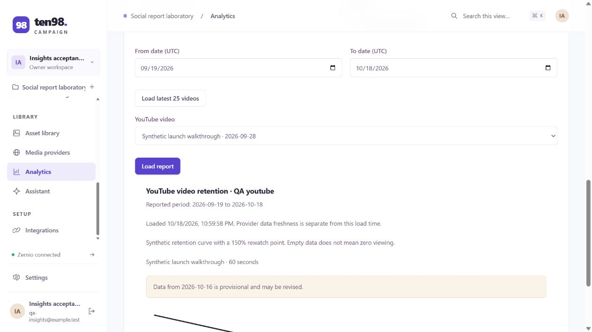

Relevant runnable checks include [connections](../tests/zernio-connections.test.mjs), [queues](../tests/zernio-queues.test.mjs), [recurring posts](../tests/zernio-recycling.test.mjs), [reports](../tests/zernio-insights.test.mjs), [leads](../tests/zernio-leads.test.mjs), [templates](../tests/zernio-whatsapp-templates.test.mjs), [inbox HTTP](../tests/inbox-http.test.mjs) and [UI checks](../tests/inbox-ui.test.mjs). Run npm test and npm run build from the repository root. The container smoke check remains scripts/check-container.mjs.

Ponytail and [Paperthin](https://github.com/LilMGenius/paperthin) read, evidence, consistency and fresh-reader checks were applied. All provider accounts and actions in these checks were synthetic. No real message, publication, upload, account change, booking, activation or spend occurred. Live provider acceptance requires approved credentials, eligibility and permissions. Remaining advanced ads/measurement/audiences/catalogs, publishing/media/bulk/per-account variants, rich messaging, advanced WhatsApp, provider contact mapping/automations, stores/additional channels and administration remain in the feature plan. Voice is excluded; organic SEO stays in ten98 Discover.

## Previous foundation release — v0.8.5

Verified on 18 October 2026 against the pinned Zernio OpenAPI 1.292.0, using isolated local databases, the production frontend and synthetic providers. **299 automated checks pass**, with no failures or skips. The production build, production container build and offline non-root container smoke check pass; the production dependency audit reports zero vulnerabilities. No dependency or application schema change was added. These checks establish application behavior; they do not establish acceptance by live providers.

The implemented additions are bounded subsets of the [full Zernio plan](zernio-feature-plan.md):

- Reddit creation and boosts require an explicitly selected pixel for all five goals. The composer can discover pixels owned by the selected advertising account. Website leads use the Lead event and a destination website; lifetime budgets require an end time. New ads start paused.
- Snapchat connections, publishing and scheduling stop before an upstream publication request while Zernio app approval remains pending. Existing drafts remain readable and save locally. Google/Reddit advertising OAuth uses the documented standalone routes and validates already-connected account receipts.
- Connection settings expose scoped account health, permissions, reconnection, display overrides, paid X background-read preferences and confirmed disconnect. WhatsApp token health remains distinct from its platform link and inbound webhook subscription. X settings remain unchanged unless explicitly enabled or disabled; provider usage charges apply.
- Current mapped profile settings and project-owned account groups can be managed. Empty global and mixed-profile groups stay outside the project interface. Group membership does not move accounts or grant project access.
- Meta, Google, TikTok, LinkedIn, Pinterest, X and OpenAI/ChatGPT support tracking-tag discovery, detail/installation-code display, event-definition reads and tag creation. Meta additionally supports rename and diagnostics. Reddit separately supports scoped pixel discovery and provider installation instructions, with pixel creation/events managed in Reddit Ads Manager. Installation code stays escaped; creating a tag does not install it on a website.
- Inbox history search includes archived conversations, pagination, direction filters and skipped/failed-account feedback. New conversations support X, Bluesky and Reddit text, verified Slack members, approved supported WhatsApp templates and Zernio SMS recipients with recorded local channel permission. Record contact permissions in Direct campaigns; both permission and suppression are rechecked immediately before dispatch. Provider acceptance is distinct from delivery.
- Publishing offers account-scoped Pinterest board, YouTube playlist and Reddit subreddit/rules/flair selection with manual-ID fallback. YouTube's saved default is an explicit choice; no playlist means none. Shared validation follows the provider's current Instagram ten-item carousel and Facebook sixty-second Reel limits.

The fresh browser pass confirms a paused Reddit lifetime creation and website-lead boost, pixel discovery within the composer, Meta tag creation/rename/events/diagnostics, profile and group creation/update, account health/update/reconnect/disconnect, Snapchat draft save followed by blocked publication, a discovered Pinterest board carried through publication, saved YouTube/Reddit destination choices, archived-history pagination, and X/WhatsApp/SMS opening messages followed by thread readback. Fixture receipts show one opening request for each of those three messaging channels and no Snapchat publication request. Bluesky/Reddit/Slack opening paths have handler tests, rather than manual send walkthroughs.

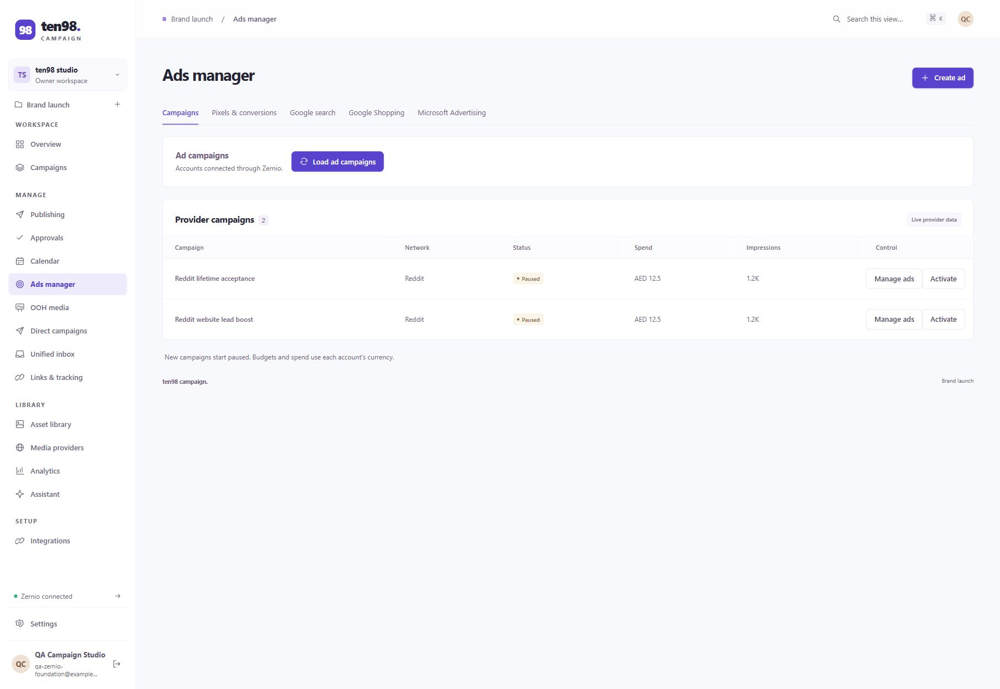

Ponytail and [Paperthin](https://github.com/LilMGenius/paperthin) read, evidence, consistency and fresh-reader checks were applied with independent code review. Those reviews caught and fixed misleading playlist-default copy, a lookup callback race, and lost action keys after gateway/pending responses. Regressions cover scopes and permissions, malformed/contradictory receipts, unknown outcomes, stale reads and retries. Follow the [runtime and dependency setup](../README.md#run-locally), then run `npm test` and `npm run build` from the repository root to reproduce the automated checks. `scripts/check-container.mjs` supplies the offline container smoke check; [container instructions](../README.md#deployment-and-operations) describe the runtime image.

All browser accounts, provider receipts and sends are synthetic. No real publication, message, upload, account change, activation, booking or spend occurred. Live acceptance requires approved provider credentials and account permissions. The full plan is **not complete**: global provisioning/admin, remaining publishing formats and libraries, advanced measurement/audiences/creative/leads/catalogs, specialist reports, rich messaging, WhatsApp lifecycle/commerce, contacts/broadcast expansion and automations remain tracked work. Snapchat unavailability was checked on 18 October 2026 and must be rechecked against Zernio before re-enabling it. Voice remains excluded; organic SEO remains in ten98 Discover.

## Previous full-app audit — v0.8.4

Verified on 18 October 2026 using isolated local databases, the production frontend build served locally and simulated providers. All **255 automated checks** pass (`npm test`), with no failures or skipped checks. The production build (`npm run build`), container build and offline non-root container smoke check pass; `npm audit --omit=dev` reports zero vulnerabilities. No dependency or schema change was added. Ponytail simplicity review and [Paperthin](https://github.com/LilMGenius/paperthin) evidence and consistency checks were applied, with separate agents reviewing changes and a fresh-context review of this release summary.

The [full coverage map](audit-coverage.md) records the reviewed function and UI action families, runnable evidence, current versus historical browser observations and acceptance limits. This release fixes:

- Google bidding reads and mutation checks reject malformed strategy, target, portfolio and freshness data. Search and Shopping money displays preserve currency precision, including 0.001 KWD.
- Surrounding whitespace cannot bypass an unresolved model request. Malformed Microsoft token metadata is rejected before account reads. Unreadable or non-object app responses retain action keys so an accepted write can be recovered without a duplicate submission.
- Calendar sync identifies the exact current plan, updates existing events after edits, and stops stale or unconfirmed batches until reviewed. Connected-account display fields are validated before reaching the UI.
- A delayed CSV file cannot replace newer file or pasted content. Selecting a replacement clears the old import immediately. Dashboard spend includes daily-budget campaigns while allocation keeps daily limits separate; missing metrics remain unknown.
- Ad media guidance follows the selected format. Closed mobile navigation is hidden from keyboard focus and its menu button exposes the expanded state.

The fresh browser pass verifies Shopping validation and paused creation with KWD precision, Microsoft recovery after an accepted but unreadable response, reviewed Search ad drafting, ad-dialog focus, dashboard budget periods, contact deduplication without implied consent, and Calendar updates after local plan edits. The Microsoft retry produced one provider creation; the Calendar update retained one managed event.

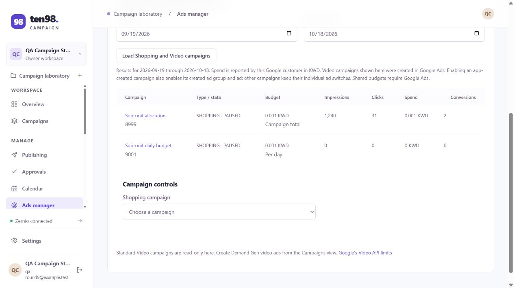

All accounts, amounts and provider receipts are synthetic. No real publication, message, upload, activation, booking or spend occurred. Live credentials and provider permissions/approvals are still required for live acceptance. The file-picker race and mobile navigation change have focused regression/review evidence, rather than a manual file-picker or resized-viewport walkthrough. Other workflows retain their historical browser evidence in the coverage map. Standard native Google Video creation remains unsupported; existing Video reporting and supported Zernio Demand Gen video creation remain available. Organic search performance stays in ten98 Discover.

## Previous full-app audit — v0.8.3

Verified on 18 October 2026 using isolated databases, the production frontend and simulated providers. All **244 automated checks** pass. The production build and offline non-root container smoke check pass; `npm audit --omit=dev` reports zero vulnerabilities. No dependency or schema change was added. Ponytail simplicity review and [Paperthin](https://github.com/LilMGenius/paperthin) evidence and consistency checks were applied, with separate agents reviewing changes and a fresh-context review of this release summary.

The [full coverage map](audit-coverage.md) records reviewed functions and UI action families, runnable evidence, fresh browser results and acceptance limits across all existing application areas. This release fixes:

- Inbox reply-window checks now page through recent history before deciding whether a reply is allowed. Incomplete or repeated pagination sends nothing.
- A local edit or deletion during initial social submission cannot be overwritten by an older provider receipt. Minimal creation receipts retain the submitted schedule and per-platform content.
- Native Google read-only preflight failures remain safely retryable; uncertain writes still require review. Shopping mappings can be disconnected after credentials are cleared, and Demand Gen exposes its supported target-CPC option.
- Older settings, Microsoft, invitation, approval and recovery reads cannot replace newer action results or errors.
- Campaign amounts retain currency precision, fractional budgets display the correct progress, and missing metrics remain unknown. Failed page loading presents a reload screen. Invitation pages and optional publishing controls are more compact; ChatGPT uses a consistent display label.

The fresh browser walkthrough covers paused Shopping, Microsoft and ChatGPT creation, reviewed ad drafting, Shopping bid readback, Microsoft reports, per-platform social approval/scheduling, Drive approval, Calendar planning, analytics, OOH booking/cancellation, replies, transactional email/SMS, WhatsApp scheduling/cancellation, and short links/QR tracking.

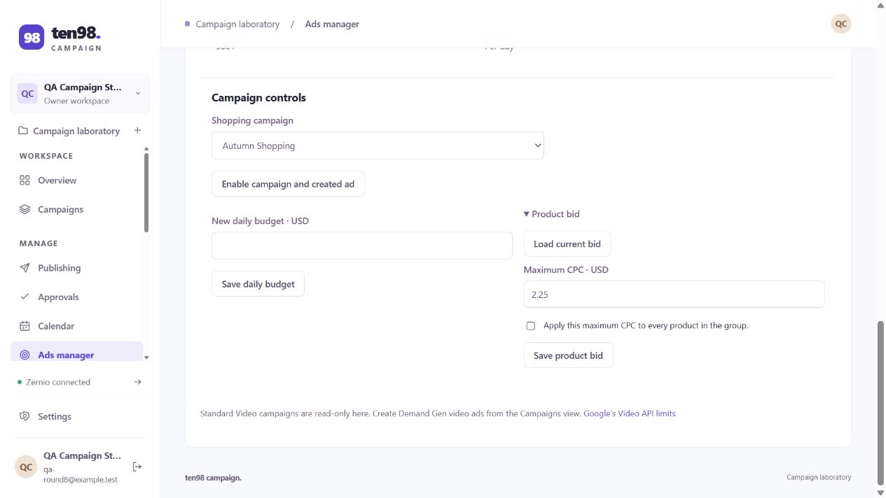

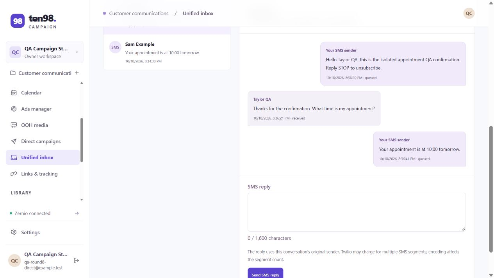

All accounts, amounts, messages and delivery states are synthetic. No real publication, message, upload, activation, booking or spend occurred. Live credentials and provider permissions/approvals are still required for live acceptance. WhatsApp sends/replies, uploads, DNS diagnostics, OAuth consent and Google Maps setup were not repeated in this browser pass; applicable local automated checks remain in the coverage map. Standard native Google Video creation remains unsupported, while existing Video reporting and supported Zernio Demand Gen video creation remain available. Organic search performance stays in ten98 Discover.

## Previous workflow audit — v0.8.2

Verified on 18 October 2026 using isolated databases and the production build against simulated providers. All **229 automated checks** pass (`npm test`), including the existing ChatGPT ads, Shopping/CPC, Microsoft, social publishing, analytics, OOH, DAM, inbox, direct campaigns and tracking regressions. The production build, offline non-root container smoke check and `npm audit --omit=dev` pass, with no known production dependency vulnerabilities. Independent review reproduced an additional targeting inconsistency, which was fixed and checked before release. No dependency was added.

| Workflow | Current evidence |
| --- | --- |
| Shopping campaign plan | The browser creates a paused Shopping campaign, then opens Campaigns and sees its USD 25 daily budget without reloading the app. Confirmed writes refresh shared records; provider failures and validation-only requests do not. A plan-refresh failure preserves the confirmed provider result and gives a reload instruction. |
| Microsoft shared budgets | The browser maps a test account, pauses its active shared-budget Search campaign and reads back Paused with the unchanged USD 100 shared amount. Recorded provider payload contains only the campaign ID and status. HTTP checks cover shared and unreadable ownership, status-only writes, blocked budget edits and mismatched readback; shared pool totals cannot overwrite local allocations. |
| Google targeting | HTTP checks verify actual returned languages, enabled devices, location reach and target/exclusion sets. Mismatched replacements and contradictory exclusion lists fail; those unconfirmed writes remain uncertain and fresh-key repeats are blocked. Demand Gen can store language/location targets on its single ad group and return empty campaign-level lists; that documented response remains supported only for the campaign's verified group. |
| Social publishing | Delayed refreshes cannot replace newer content or cancellation evidence, even within the same timestamp. A conflicting local change after an accepted provider write preserves the latest record and blocks repeats pending review. Queued signed webhooks cannot revive confirmed provider deletions. |
| Interface | Provider cards show status first; connection fields and setup instructions expand when needed. A browser tests the saved Shopping connection, generates a draft, and opens Usage and cost using the keyboard. Draft review actions and charge evidence remain available. |

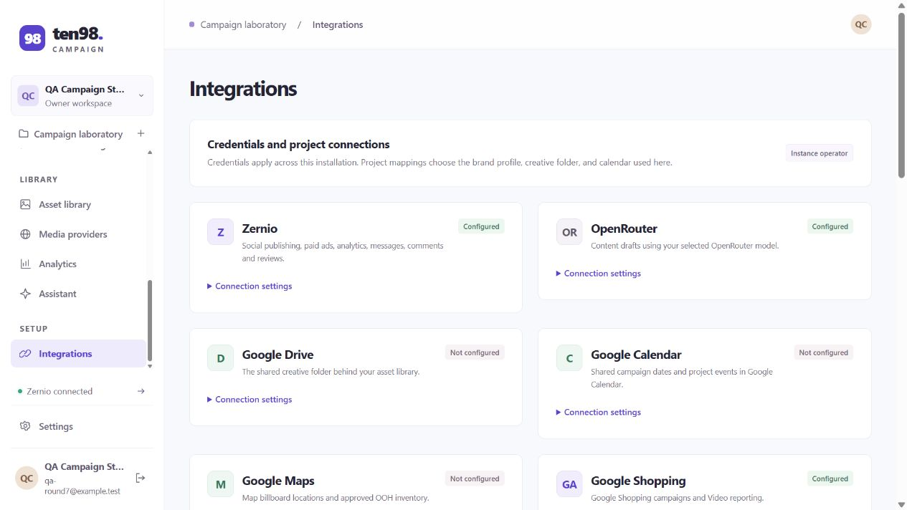

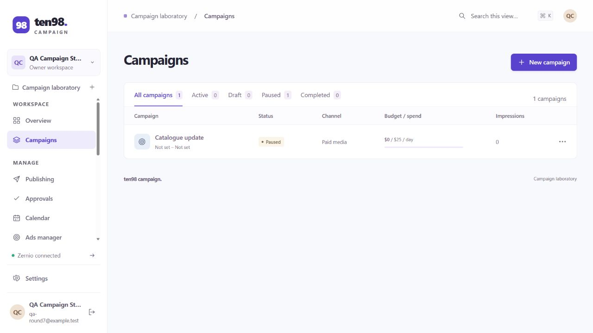

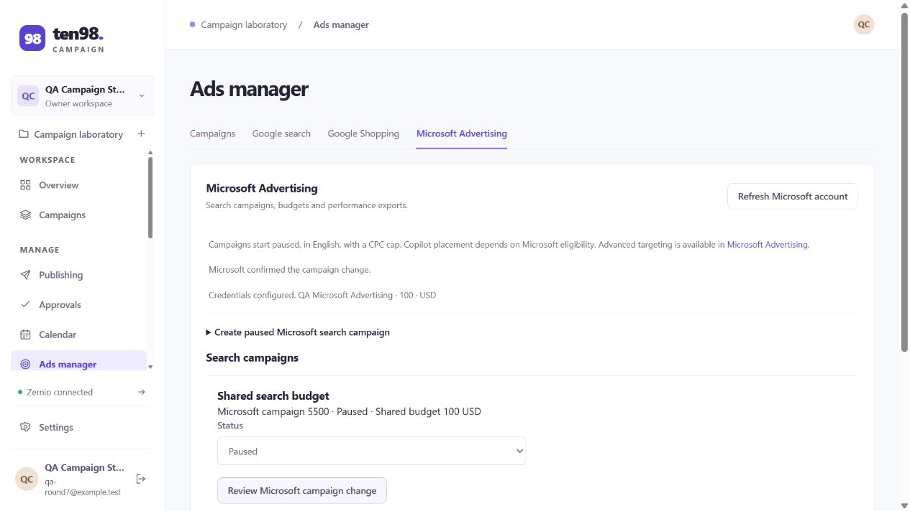

Runnable regression evidence is in [campaign UI](../tests/ads-workflow-ui.test.mjs), [Microsoft](../tests/native-microsoft-ads.test.mjs), [Google tools](../tests/google-ads-tools.test.mjs), [social snapshots](../tests/social-dam-round4.test.mjs) and [webhooks](../tests/webhooks.test.mjs). The full suite reruns all other areas; older manual walkthroughs below remain evidence from their stated releases. The new Google targeting checks follow [Zernio's replacement and returned-state contract](https://docs.zernio.com/ad-campaigns/update-campaign-targeting).

All accounts, provider states and amounts above are synthetic. No real publication, message, upload, activation, booking or ad spend occurred. Live provider acceptance still needs configured credentials, permissions and approvals. These checks establish application behavior against simulated contracts, not live provider delivery or placement.

## Previous campaign controls audit — v0.8.1

Verified on 18 October 2026 with isolated databases, simulated providers and the production frontend. All **223 automated checks** pass (`npm test`), covering ads, social publishing, analytics, OOH, DAM, inbox, replies and direct campaigns. The production build and offline non-root Docker smoke check pass. `npm audit --omit=dev` reports no known production dependency vulnerabilities. No dependency was added. Ponytail and Paperthin evidence, consistency and independent reviews were applied.

| Area | This audit's evidence |
| --- | --- |
| Shopping | Browser validation creates no resources; explicit creation produces a paused campaign. The report distinguishes a USD 500 campaign-total allocation from a USD 25 daily budget. The product-bid editor saves USD 2.25 and displays the provider-confirmed readback. HTTP checks update the app-created single all-products group and listing atomically, and reject externally changed partitions, automated bidding and total-budget daily edits. Switching campaigns resets unsaved controls and confirmation. |
| Microsoft Advertising | The browser verifies account mapping, creates a paused Search campaign and requests a report that progresses from Pending to a completed ZIP link. HTTP checks use the REST `MaxClicks` bidding discriminator, retain compatibility with older readback, and verify creation, status, budget, report scope and uncertain outcomes. The synthetic export file is not downloaded. |
| ChatGPT ads and shared controls | Actual HTTP checks cover connect, validation without creation, paused creation, replay, activation, budgets, permissions and uncertain outcomes. Archived/deleted ads cannot be reactivated. Campaign-wide budgets block ad-set budget changes. Confirmed changes update only the matching local campaign; a concurrent change to the same provider campaign is rejected until the current change and its readback finish, preventing older receipts from overwriting newer state. |
| Google paid search | Stale bidding, targeting and negative-keyword responses cannot authorize or confirm writes. Repeated pagination cursors fail, Planner rejects private seed URLs and historical requests reject unsupported seed URLs. |
| Inbox and direct campaigns | Archive/reopen receipts must match the requested conversation. Invalid calendar dates and timezone-less scheduled sends fail before delivery records are queued. Existing replies, publication, analytics, OOH, DAM and tracking regressions pass. |
| Interface | Sign-in uses one compact form. Advertising has separate Campaigns, Google search, Google Shopping and Microsoft Advertising views. A browser opens a native campaign's provider view, generates an Assistant draft, reviews its retained creative in the ad builder, selects the account and budget, and creates a paused Google Search campaign. Promotional slogans and repeated technical copy were removed. |

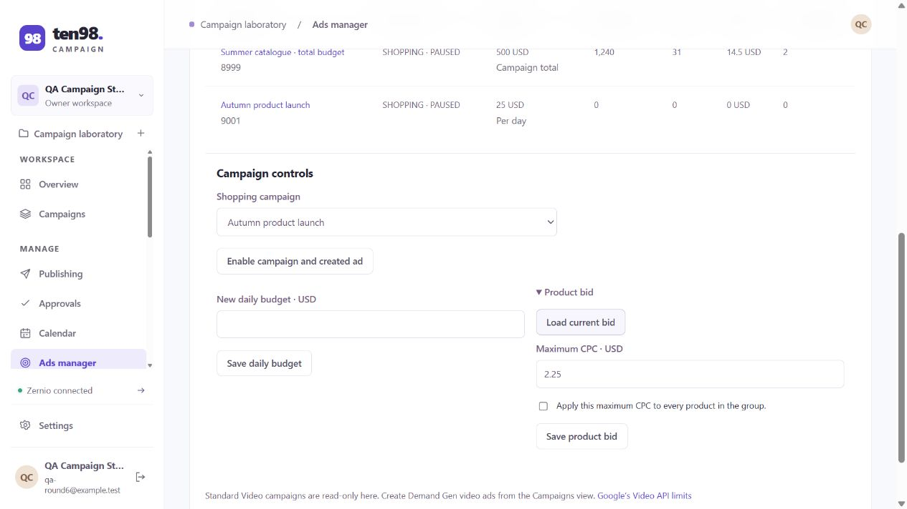

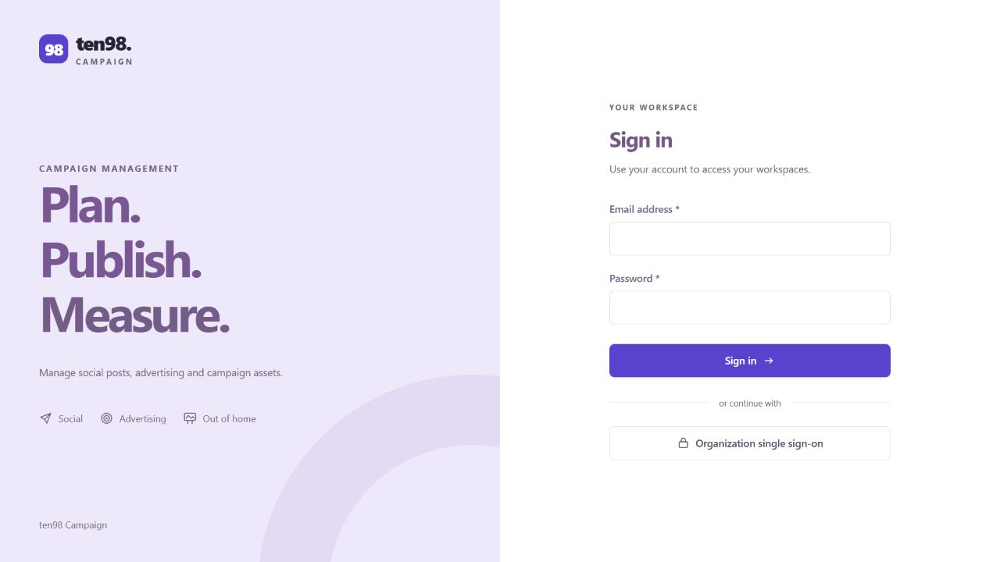

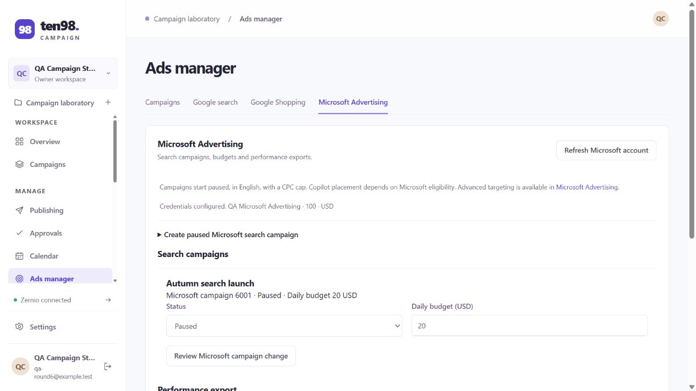

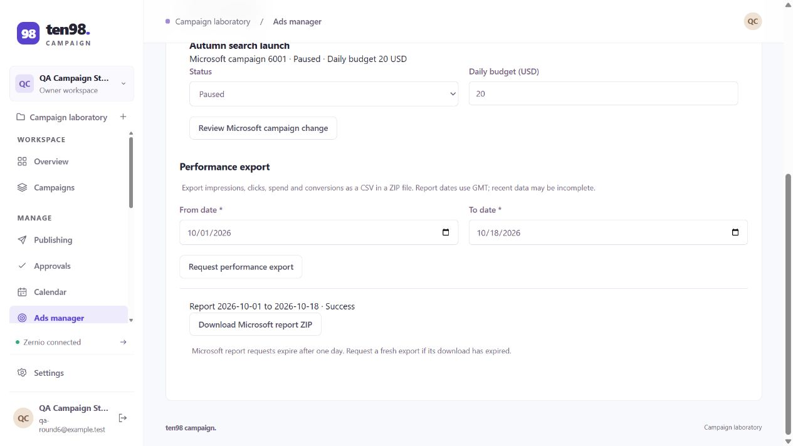

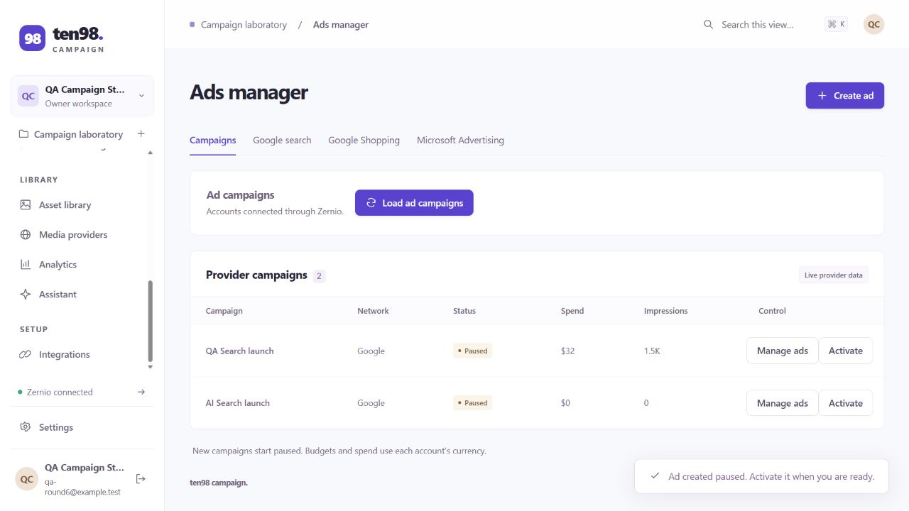

Relevant runnable checks: [Shopping](../tests/native-google-ads.test.mjs), [Microsoft](../tests/native-microsoft-ads.test.mjs), [ChatGPT and shared campaign controls](../tests/openai-ads.test.mjs), [Google search](../tests/google-ads-tools.test.mjs), [campaign UI](../tests/ads-workflow-ui.test.mjs), [inbox](../tests/inbox-http.test.mjs) and [direct schedules](../tests/direct-campaigns-http.test.mjs). The release commands below repeat the automated checks; screenshots come from the manual browser walkthrough.

These results use synthetic accounts and provider responses. No real publication, message, upload, activation, booking or ad spend occurred. Live acceptance still needs configured credentials, permissions and provider approvals. Standard Video campaign creation remains unsupported by the Google Ads API; existing Video reporting and Zernio Demand Gen creation are supported. Organic search performance remains in ten98 Discover. Older screenshots and walkthroughs below were recorded in their stated releases; their automated regressions were rerun, without claiming fresh browser verification of every provider.

## Previous paid advertising audit — v0.8.0

Verified on 18 October 2026 with isolated local applications, temporary databases, the production frontend and simulated providers. All **214 automated tests** pass, including existing social publishing, analytics, OOH, DAM, inbox and direct-campaign regressions. The production build, non-root offline Docker smoke check and production dependency audit pass; the audit reports no known production dependency vulnerabilities. Ponytail and Paperthin correctness, evidence, consistency and independent cold-read reviews were applied. No dependency was added.

| Area | Browser and automated evidence |
| --- | --- |
| AI ad drafting | The browser requests a Google Search creative, opens Review in ad builder, retains headlines/descriptions/keywords/destination, explicitly selects the account and budget, and creates a paused campaign. Automated checks reject unsupported proposal fields and private media, keep proposals local, enforce permissions and discard stale results. |
| ChatGPT ads | Browser validation succeeds without creation, followed by explicit paused creation. HTTP/UI checks cover connection scope, secret handling, supported daily/lifetime goals and bidding, conversion events, URL macros, dry-run validation and budget changes. |
| Google paid search | Browser selects the connected account/campaign/ad group, adds an exact-match keyword and reads back the new row. HTTP/UI checks cover keyword state/deletion, negatives, search terms, Planner, targeting, bidding, scope and uncertain writes. |
| Native Shopping | Browser validates without resources, creates a paused Shopping graph, enables its tracked campaign/group/ad, changes the budget from USD 25 to USD 30, pauses it and reloads the confirmed state. Automated checks cover atomic requests, country resolution, shared budgets, exact resource scope, readback, malformed reports, permission changes and duplicate prevention. |
| Native Microsoft | Browser verifies customer/account mapping, creates a paused Search campaign with responsive ad/keywords/location, explicitly changes it to Active with USD 24 daily budget, requests a report, observes Pending then Success and receives its scoped ZIP export link. HTTP checks verify exact creative/targets, roles, report scope, optional readback fields, uncertain outcomes and concurrent token renewals. The browser does not download a fabricated external report file. |
| Credentials and records | Actual HTTP tests rotate both native providers' refresh tokens, restart the app, retain encrypted values, reject stale administrative changes, and prevent manual creation/edit/deletion of native delivery evidence. Concurrent Microsoft refreshes no longer interrupt another creation. |
| SMS attachments | Signed incoming media reaches a same-origin authenticated download route. HTTP checks cover owner/viewer access, foreign projects, missing attachments, protected Twilio authentication, allowed redirects, MIME/20 MB limits, failures and access revoked during download. |

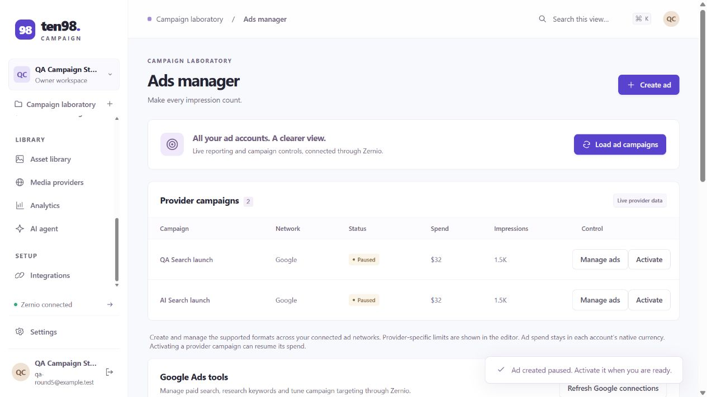

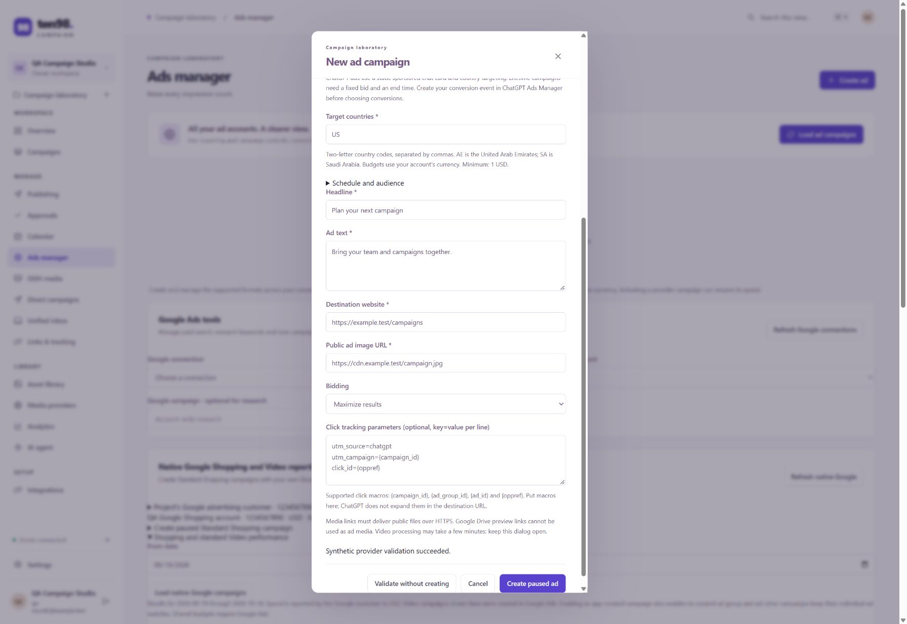

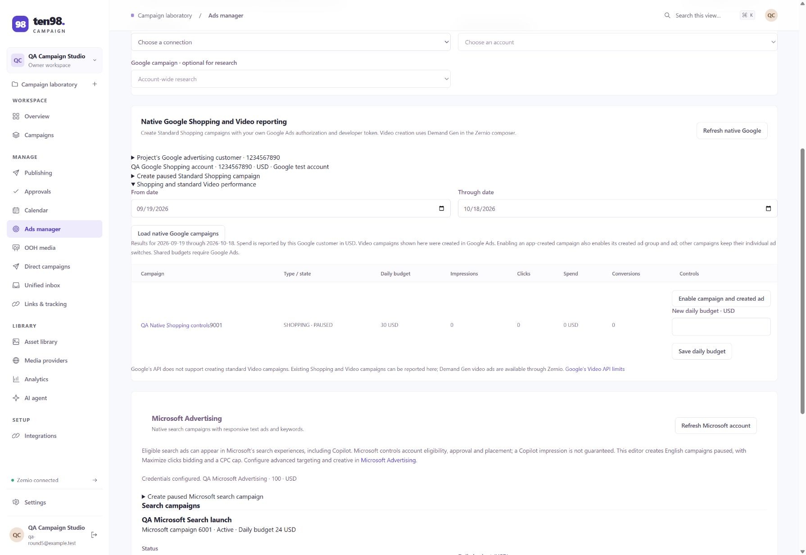

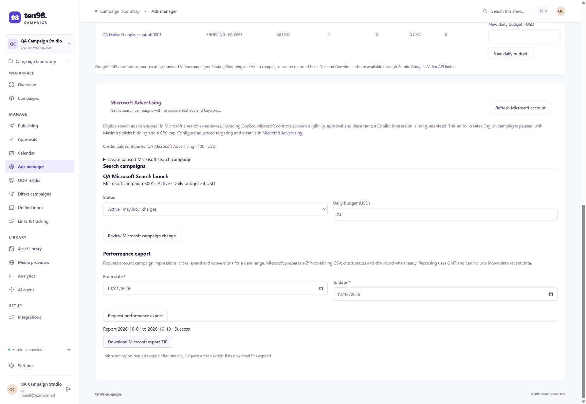

The new checks are in [AI drafts](../tests/ai-ad-drafts.test.mjs), [OpenAI Ads](../tests/openai-ads.test.mjs), [Google tools](../tests/google-ads-tools.test.mjs), [native Google](../tests/native-google-ads.test.mjs), [native Microsoft](../tests/native-microsoft-ads.test.mjs), [credential HTTP routes](../tests/settings-http.test.mjs) and [SMS media](../tests/sms-media.test.mjs). Runnable release commands remain below.

These are synthetic results, including all displayed spend, delivery and report states. No real publication, message, upload, activation, booking or media spending occurred. Live acceptance requires configured credentials, permissions and provider approvals. Standard Google Video creation is unsupported by its API; existing Video reporting and Zernio Demand Gen creation are supported. Copilot and Google AI search placement eligibility do not guarantee impressions. Organic Search Console stays in ten98 Discover. See [advertising setup and limits](advertising.md).

## Previous full-app workflow audit — v0.7.5

Verified on 18 October 2026 using actual HTTP handlers, temporary databases, mocked providers and the production frontend. This pass traced ads, social publishing, analytics, OOH, Drive DAM, inbox and direct campaigns, then reran the full regression suite. Ponytail simplicity review and [Paperthin](https://github.com/LilMGenius/paperthin) evidence, consistency and cold-read checks were applied. No dependency was added, and no real publishing, delivery, upload or media spending occurred.

| Area | Verified behavior |
| --- | --- |
| Inbox | Older loaded SMS messages remain visible after polling, and Load older still reaches the rest. Newly received conversations may make Load more revisit a page so no unseen conversation is skipped. A failed conversation selection still leaves current-thread updates operational. Messenger, comment, review and WhatsApp reply regressions pass. |
| Ads | Boost geography is sent in the provider's targeting object. Daily budget editors reject lifetime allocations, including conflicting `budget`, `campaignBudget` or `adSetBudget` values. Valid daily updates and the existing format/control checks still pass. |
| Social publishing | Changing the shared plan time updates existing account-specific overrides; leaving it unchanged preserves distinct account times. Updates validate their receipt and read back scoped provider state before replacing local variants. A failed readback retains local data and blocks duplicate updates until reviewed. Failed-only retries, approval, captions, media and restriction checks still pass. |
| Analytics | Object-valued platform labels are rejected before rendering. A browser loads 42 mock impressions, then receives a malformed refresh: the error remains readable and the last valid report stays visible. Missing metrics remain unknown. |
| OOH | Strict proposal-item reads request screen IDs explicitly. Booking accepts an empty or text acknowledgement, then requires the existing scoped status/terms readback. Unconfirmed results remain uncertain and cannot be replayed. Inventory, exact screen/price terms, availability, delivery, cancellation and Maps regressions pass. |
| Drive DAM | A canonical empty Drive file collection can omit its file array without failing sync or deleting assets. Arbitrary or malformed objects remain errors. Existing atomic import/upload, metadata, approval, delivery-URL and uncertain-upload workflows pass. |
| Direct campaigns | A late SMS send acknowledgement cannot replace the sender already established by a signed delivery callback or create a second reply route. Conflicting refresh routing is also rejected. Transactional email, SMS and WhatsApp audience, queue, consent, callback, cancellation and reply regressions pass with isolated providers. |

The new manual browser walkthrough opens a synthetic 205-message SMS conversation, loads its second 100-message page, allows automatic polling, then loads the final five messages. All 205 messages remain loaded, the oldest note is reachable and the older-page button disappears after the last page. The fixture blocks external requests and uses a separate database and synthetic identity; its delivered labels are seeded test records, not carrier delivery evidence.

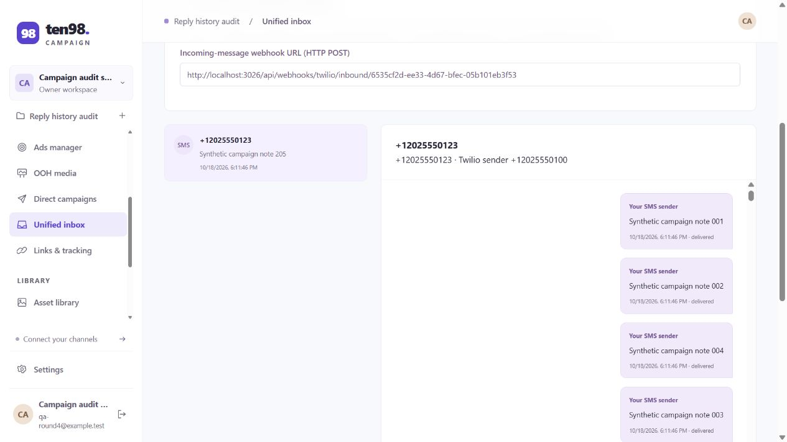

Provider-boundary checks follow [Broadsign's OpenAPI](https://direct.broadsign.com/api/v1/apidocs.json), [Zernio's schedule overrides](https://docs.zernio.com/guides/platform-settings) and [update receipts](https://docs.zernio.com/posts/update-post), and [Google's empty-result handling](https://developers.google.com/workspace/drive/api/quickstart/nodejs).

The v0.7.4 manual browser walkthrough signs into an account with no projects, creates a workspace and saves a campaign through the production frontend. Its [starting screen](onboarding-start-verification.png) and completed campaign remain documented below.

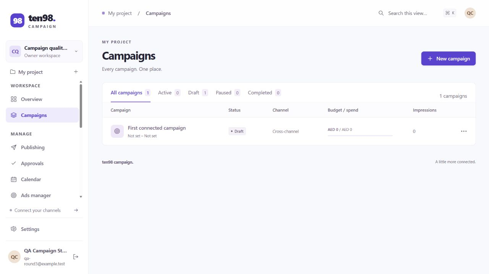

The v0.7.3 browser retried one failed LinkedIn destination while preserving the original Facebook post URL. Recorded requests show one retry and a preflight containing only LinkedIn. Both destinations then appear published. Native HTTP checks additionally cover required approval, incomplete retry receipts, duplicate actions and disconnected successful accounts.

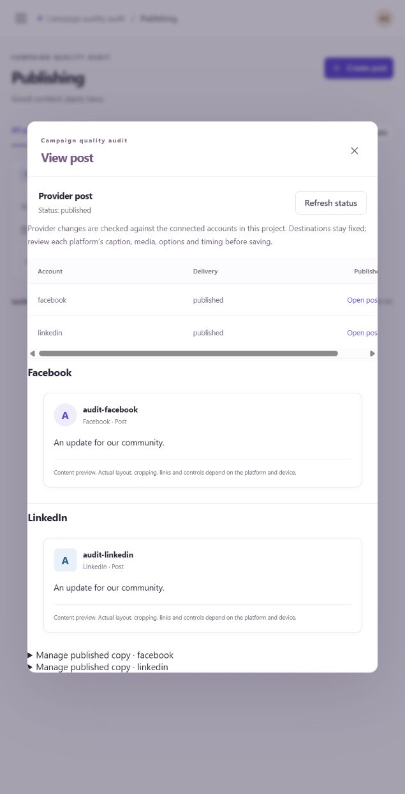

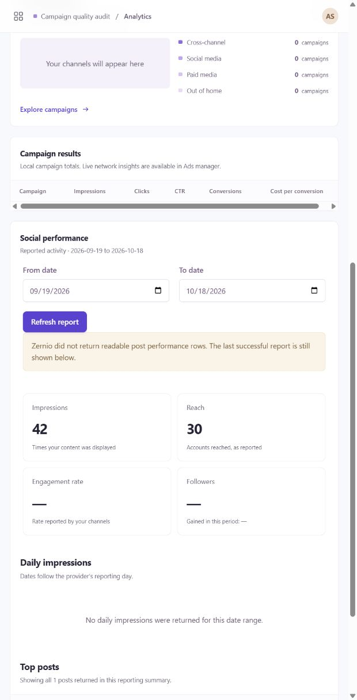

The full suite passes **191 automated tests** (`npm test`). The production build, non-root Docker image smoke check and production dependency audit also pass, with no known production dependency vulnerabilities reported. Earlier account access, assistant recovery, shared Google settings, Calendar timezone, session/role revocation, password, DNS persistence and newer-draft protection regressions also pass. The v0.7.2 delayed-save browser proof remains in [draft recovery](draft-recovery-verification.png). This audit and its screenshots use synthetic identities; they establish application behavior against simulated provider contracts, not live account acceptance.

The new checks live in [social and DAM](../tests/social-dam-round4.test.mjs), [OOH](../tests/ooh-round4.test.mjs), [inbox UI](../tests/inbox-ui.test.mjs) and [SMS delivery/replies](../tests/sms-inbox.test.mjs). For an uncertain operation, an instance operator who administers the workspace checks the provider dashboard, then records Applied or Not applied in Settings; see [operator recovery](../README.md#deployment-and-operations). Only Not applied permits a new manual attempt. Older browser walkthroughs were not repeated in this pass; their automated regressions were rerun. The commands below repeat automated checks; screenshot capture is manual.

Use this release's checkout with Node.js 22.14+, installed npm dependencies, Docker and PowerShell to repeat the release checks:

```powershell
npm test
npm run build
npm audit --omit=dev
docker build -t ten98-campaign:review-check .
Get-Content -Raw scripts/check-container.mjs | docker run --rm -i --network none --entrypoint node ten98-campaign:review-check --input-type=module
```

## Replies, short links and tracking

Verified on 18 October 2026 with the production frontend bundle served by isolated local apps, private test databases and synthetic contacts. Provider API calls were intercepted in process by local mocks; all other non-loopback requests were blocked. No real SMS, WhatsApp or email was sent, and no DNS or TLS configuration was changed.

| Area | Result |
| --- | --- |
| SMS replies | Open replies from a selected campaign, read its signed incoming message, submit one reply from the original Twilio sender, then process a signed delivery receipt. A signed STOP displays the opt-out and disables reply controls. Native HTTP checks create the originating contact/campaign, preview and send it, then verify interrupted replies across a real database restart. |
| WhatsApp replies | Open the campaign's scoped account, send one free-text reply inside the service window and read it back. An expired-window attempt preserves its draft. Switch to an approved template, verify required-field validation, fill the name and URL suffix, send once and read back the template text. Recorded requests contain the exact account, template name, language and numbered parameters. |
| Short links | Create a named campaign-associated URL in the browser, render its QR preview, verify its immutable destination and separate campaign report. Automated checks also exercise branded-domain changes, archive/restore, a valid 253-character hostname and rejection above that limit. Deleting a project invalidates its redirects/scripts/event intake and removes its counters while another project remains operational. |
| QR and tracking | Independently decode the actual HTTP SVG and verify its exact QR-tagged URL. One ordinary request and one QR request each count once; HEAD, DNT and GPC requests add nothing. A real browser loads the production tracking script, visits the initial page, changes path and goes back: three pageviews. Query-only replacement adds none. A button emits one enquiry event. The UI and HTTP report show one ordinary click, one QR visit, three pageviews and one event, with no private query or fragment content. Campaign filtering retains link counts and excludes unassociated website events. |
| Email reply routing | Native provider checks verify Cloudflare's configured `reply_to` field. Receiving and forwarding remain external Cloudflare Email Routing configuration. |


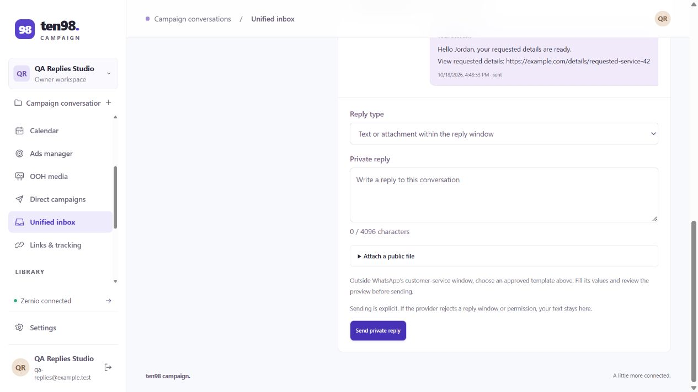

The full suite also covers signed callbacks and restart recovery, durable opt-outs, duplicate/uncertain replies, original-sender attribution, expired WhatsApp windows and approved templates, malformed provider templates/warnings, stale account/project responses, link permissions and immutability, public URL validation, campaign isolation, project deletion, tracking privacy signals, CORS, intake limits and SPA page changes. Reply and tracking browser proof was recorded in v0.7.1 using synthetic contacts, one mocked SMS reply and two mocked WhatsApp replies; delivered/read states do not establish real carrier acceptance. Those regressions pass in this release.

Live provider acceptance still requires configured credentials, approved accounts and public HTTPS callbacks. Website-script browser verification used a separate loopback test instance; native checks cover branded HTTPS origins. DNS, TLS and reverse-proxy routes must be provisioned by the operator. The domain-check challenge does not independently verify ownership. Tracking measures requests/events, not unique people or independently verified ad conversions. See [setup and limits](tracking.md) and [inbox setup](inbox.md).

The browser walkthroughs below were recorded in earlier releases with the same isolated-provider approach. Their native regressions also pass in this release.

## Unified inbox release

Verified on 18 October 2026 with the production frontend, an isolated local app, synthetic identities and mocked Zernio responses. No real private message, public comment or review response was sent.

| Area | Browser result |
| --- | --- |
| Messenger | Load only the project's connected page, open incoming history, send one private reply, mark read, archive and reopen; the reopened row returns to the active list. Account-specific character limits are visible. |
| Contacts | Signed incoming webhook creates Alex's contact; opening older incoming history creates Sam's contact. Repeated reads retain two identities. Both appear in Direct campaigns with Messenger source and no email/SMS/WhatsApp consent. |
| Comments | Open a scoped post/thread, send a public child reply, read it back, like a comment and read back the changed reaction. |
| Reviews | Load a Google Business review, add a public response, then explicitly approve replacing it and read the updated text back. |

The recorded mock requests confirm durable operation keys and exact scoped account/resource payloads. Native HTTP checks also cover signed replay/conflicts, contact atomicity, permissions and reply windows, attachments, duplicate/uncertain sends, deep comment replies, Meta ad routing, Instagram hidden-comment recovery, malformed provider data, stale review versions, permission changes during preflight, and project isolation. Live acceptance requires configured accounts, permissions and webhook subscriptions; see [inbox setup](inbox.md).


## Direct campaigns release

Verified on 18 October 2026 in an isolated local app with synthetic contacts, the production frontend and mocked providers. No real email, SMS, WhatsApp messages or voice calls were sent. The QA proxy supplied the fixed HTTPS app origin for callback/unsubscribe contract testing; production requires an actual public HTTPS address.

| Area | Browser result |
| --- | --- |
| Contacts | Preview/import a CSV with a repeated address, a disposable domain and an invalid address; merge the duplicate; show row errors, channel-specific consent and a disposable-domain flag. |
| Email | Create a transactional draft; personalize the eligible contact; exclude the disposable address; explicitly confirm the message purpose; submit to the Cloudflare mock; show its confirmed delivery receipt. Optional sandboxed HTML renders escaped personalization and blocks external content. |
| SMS | Save a future local-time schedule, restart the QA app and retain that schedule; create an immediate campaign with personalization, segment estimates and STOP footer; show two delivered mock receipts. |
| WhatsApp | Load the scoped account and approved template/language; fill template values; preview the exact text; explicitly submit a broadcast; refresh both recipient statuses to delivered. |


Native checks cover contact hygiene and consent evidence, CSV dry runs/deduplication, MX/null-MX/A/AAAA outcomes, durable destination suppression, email purpose and unsubscribe, exact provider payloads, approved WhatsApp media/button options, queue scheduling, in-flight cancellation, stale confirmations, lost acknowledgements/restart recovery, signed callbacks and opt-outs, stale delivery readback, and actual frontend handlers.

Real delivery remains dependent on configured credentials, account approval and provider access. Cloudflare permits transactional email only; queued email has no per-message delivery lookup, and suppression refresh is not an open/click report. DNS and disposable/typo heuristics do not prove that an individual mailbox exists. Voice campaigns remain excluded. See [direct campaign setup and limitations](direct-campaigns.md).

## Existing campaign workflows

Verified on 18 October 2026 with the production frontend, actual local HTTP server, isolated database and synthetic accounts. Provider mocks blocked external API calls and recorded requests. Existing user data and credentials were not used for tests.

## Five-area browser walkthrough

| Area | Verified workflow |
| --- | --- |
| Ads manager | Connected Meta/native account selection; create a paused image campaign; load campaign spend/impressions; scoped ad details; edit and read back a headline; pause an ad; rename an ad set and change its daily budget with provider confirmation. |
| Social publishing | Select Instagram/Facebook accounts; attach approved Drive-backed artwork and a campaign; separate Instagram caption/first comment; shared Facebook copy; effective previews and preflight; require approval, request review and approve; explicitly schedule at 10:30 Dubai time and verify `2026-11-04T06:30:00.000Z` in the provider request. |
| Analytics | Load the requested reporting window; verify impressions, reach, followers, engagement, daily chart and post metrics against the fixture. Missing local campaign metrics remain unknown; explicit zeros are preserved. |
| OOH | Approve domain/client/screen scope; sync inventory and coordinates; save a proposal; use the provider-calculated quote; check availability; explicitly approve booking; refresh exact line-item delivery totals; request cancellation, retain its pending state, then reconcile confirmed cancellation into the shared plan. |
| Drive DAM | Sync original links and thumbnails; upload a document; edit public delivery media, tags and description; approve artwork; repeat sync without duplicates; preserve unchanged approvals; reset approval when source metadata changes; reuse the asset and description/alt text in social publishing. Invalid provider metadata leaves assets unchanged. |

Read-only checks of the recorded requests and isolated database verified the same results, including one uploaded document, exact caption/options/alt-text payloads, UTC scheduling, approved review state, ad-set budget/name changes, and cancelled provider placements. No real ad activation, booking, upload or social publication occurred.


## Runnable checks

Run `npm run build` and `npm test`. Temporary HTTP servers/databases, provider mocks and actual frontend handlers cover authentication/OIDC, roles, invitations, encrypted integration settings, calendar/maps behavior, provider recovery, approvals, direct campaigns, the unified inbox and the five areas above.

The ads HTTP check creates 20 supported format combinations: Meta image/video/carousel, Google Search/Display/Performance Max and Demand Gen variants, LinkedIn image/video, TikTok video, Pinterest image, X cards, ChatGPT cards, and Reddit image/video/carousel/text. It also checks creative/status/budget changes, supported renames, partial-post boosts, malformed acknowledgements, date handling, isolation and connection races.

Drive checks cover concurrent imports, repeated IDs and pages, incomplete/malformed responses, atomic rollback, media metadata, preserved manual fields/approvals, GIF restrictions, alt text, uploads and uncertain acknowledgements. OOH checks include inclusive date limits, inventory normalization, idempotency, booking/delivery/cancellation, stale-report races and confirmed-write refresh recovery. Social checks cover per-platform persistence, immediate publishing/scheduling/updates/retries, all creative references, approval invalidation, creator permissions and stale UI recovery. Analytics checks cover inclusive reporting windows, numeric/null/zero values and foreign or malformed rows. Project-change checks prevent delayed uploads or old callbacks from starting writes in a former project.

## Fixes completed

- Ad lists enforce the selected campaign/network locally; successful copies of partially delivered social posts can be boosted after fresh account checks.
- Google advertising dates preserve the account's calendar date, including single-day campaigns. Unsupported renames and Smart+ creative edits fail before provider writes; Display creative editing is exposed.
- Create/boost and mutation acknowledgements validate identity, scope and confirmation. A failed details refresh after a confirmed write cannot encourage another edit until refreshed.
- Approval results and initial provider-status refreshes update the UI correctly. Missing local metrics no longer appear as fabricated zero values or invalid ratios.
- OOH screens use normalized IDs, date windows are inclusive, and stale reads cannot overwrite cancellation receipts. Confirmed actions with failed follow-up loading require an explicit refresh before further changes.
- Drive metadata is validated before atomic imports, deduplicated and retained for publishing restrictions. GIF and alt-text handling are consistent with the asset library.

## Live account acceptance

No real provider credentials were supplied for these tests. Live Zernio delivery, ad permissions/spend, Google Drive/Shared Drive access, Google Maps rendering with a billed/referrer-restricted key, public HTTPS webhooks, and Broadsign account behavior require acceptance with the operator's configured accounts. Google Maps coordinates and loader behavior were checked; a real Google map render was not claimed without a key. Provider-specific creative trafficking and unsupported native controls remain the documented dashboard workflows in the README.
