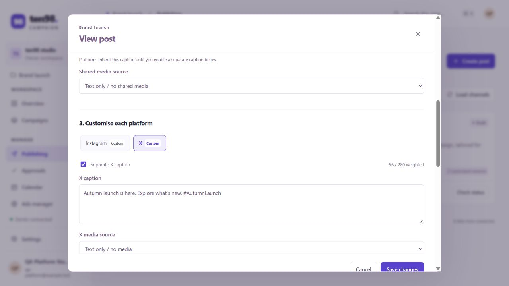
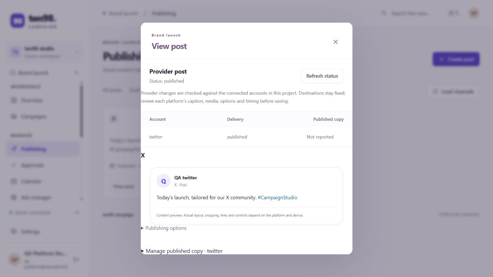
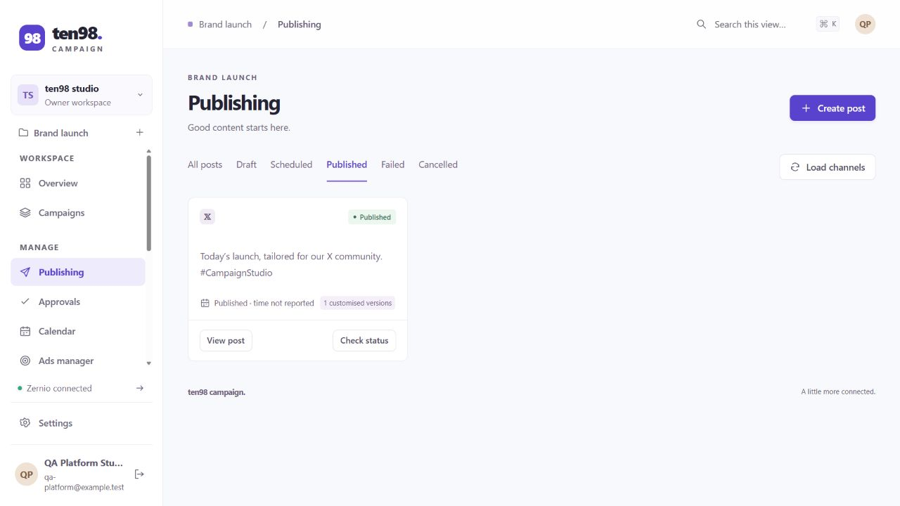

# End-to-end verification — v0.4.0

Verified on 18 October 2026 using an isolated database and synthetic accounts. Saved user records, passwords and integration credentials were not changed.

## Browser walkthrough

The production frontend ran against the actual local HTTP server. An isolated Zernio mock recorded outgoing payloads and blocked external provider requests.

| Workflow | Result |
| --- | --- |
| Local sign-in and navigation | Passed; campaign navigation has no inbox. |
| Instagram and X destination/account selection | Passed; selected accounts remained selected after reopening. |
| Shared and separate captions | Passed; independent captions survived saving and reopening. |
| Separate media and publishing options | Passed; Instagram image, alt text and first comment stayed independent from X's explicit text-only media set and reply settings. |
| Media inspection and previews | Passed; file-check results retained size/MIME metadata and showed the effective platform content. |
| Restriction feedback | Passed; required Instagram media appeared as a restriction; rejected provider preflight displayed its reason. |
| Scheduling | Passed; 18 November at 09:30 Dubai time became `2026-11-18T05:30:00.000Z`. The recorded request contained the exact per-platform captions, media and options. |
| Update and reschedule | Passed; the Instagram caption changed independently, the X version remained, and the new 10:45 Dubai time became 06:45 UTC. |
| Return to provider draft | Passed; clearing the time submitted `isDraft: true`. A regression check also covers stale historical schedule metadata on later status reads. |
| Immediate publishing | Passed; an empty shared caption and separate X caption/options reached the mocked provider with `publishNow: true`. |
| Mandatory preflight | Passed; explicit checking and the Publish action both rejected a synthetic provider restriction. The recorded requests confirmed that no extra publication was created. |
| Submitted-copy preview | Passed; the view displayed the exact X copy rather than the empty shared caption. |

## Runnable checks

Run `npm run build` and `npm test`. All 51 native Node checks passed. These checks use temporary databases/HTTP servers, mocked provider responses, and actual frontend handler logic. They cover authentication/OIDC/invitations, role boundaries, encrypted settings, connection probes, Drive/Calendar/Maps, content approvals, social publishing lifecycle, advertising formats, Broadsign proposals/bookings, AI usage recovery, and record lifecycle.

This release adds checks for the shared platform contract, structured options, weighted counters, media restrictions, variant persistence and explicit resets, project-scoped DAM references, exact publishing/scheduling/update/retry payloads, provider preflight failures, creator permissions, divergent account copies, approval invalidation and races, and preview behavior. Removed inbox routes return 404 without contacting Zernio; application state and assistant tools cannot access retained private inbox records. Post webhooks retain signature, deduplication, tenant-isolation, ordering and restart checks. New unsupported events are ignored with their content redacted.

## Live acceptance

No real Zernio, OpenRouter, Google, Broadsign or OIDC credentials were supplied. Live delivery, account permissions, Google Maps billing/referrer restrictions, public HTTPS webhook delivery, and identity-provider configuration still require account-level acceptance. These checks establish application behavior and mocked contracts, not external account acceptance. The README documents provider-specific limits and workflows that remain in provider dashboards.
