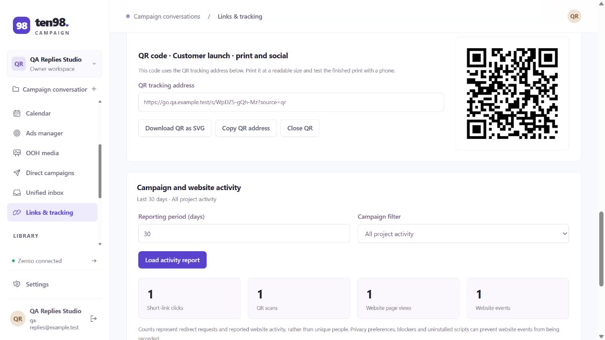
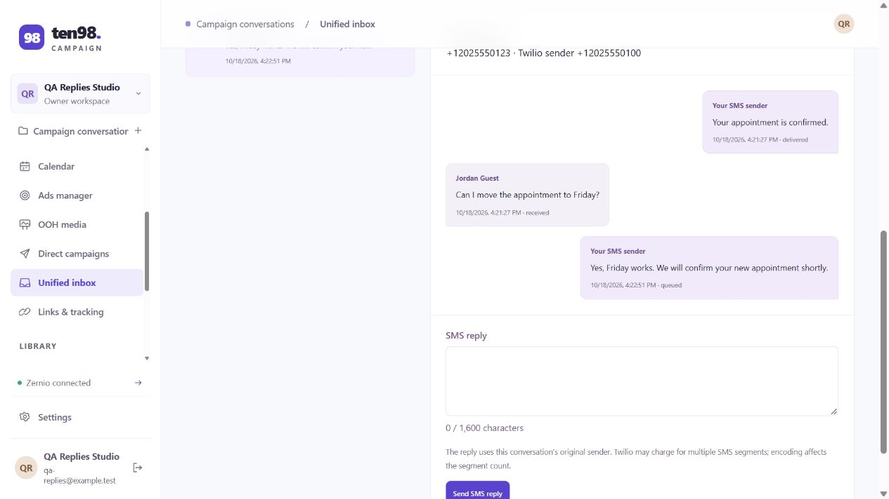
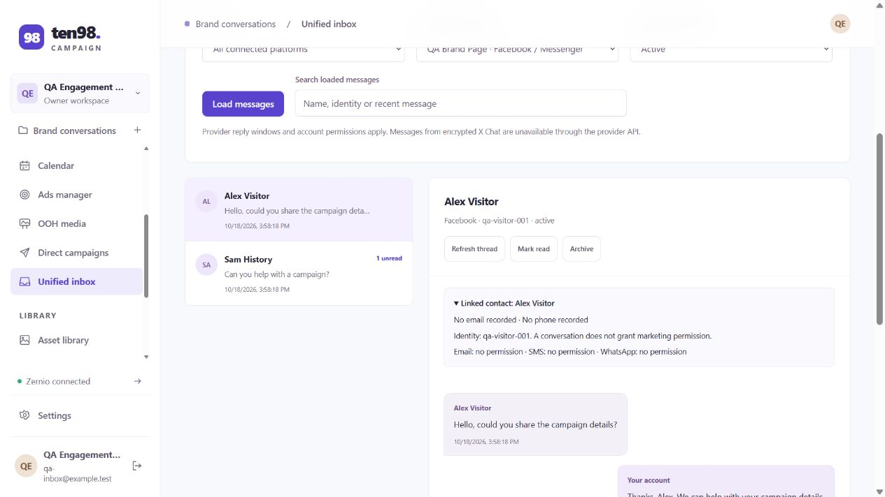
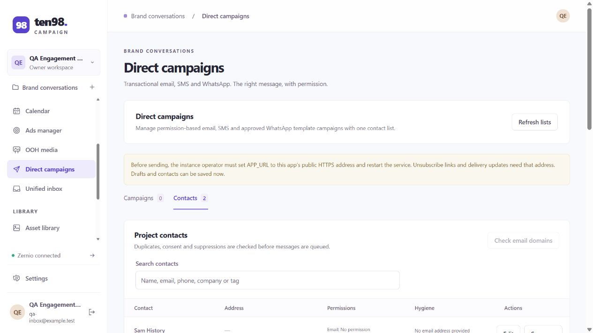
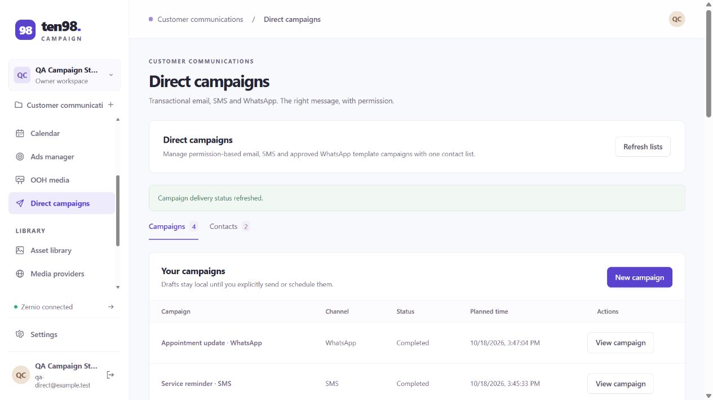
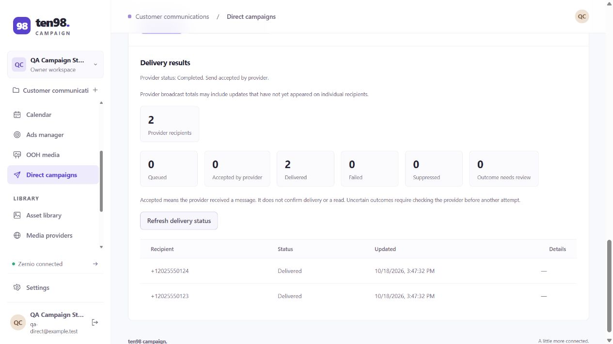
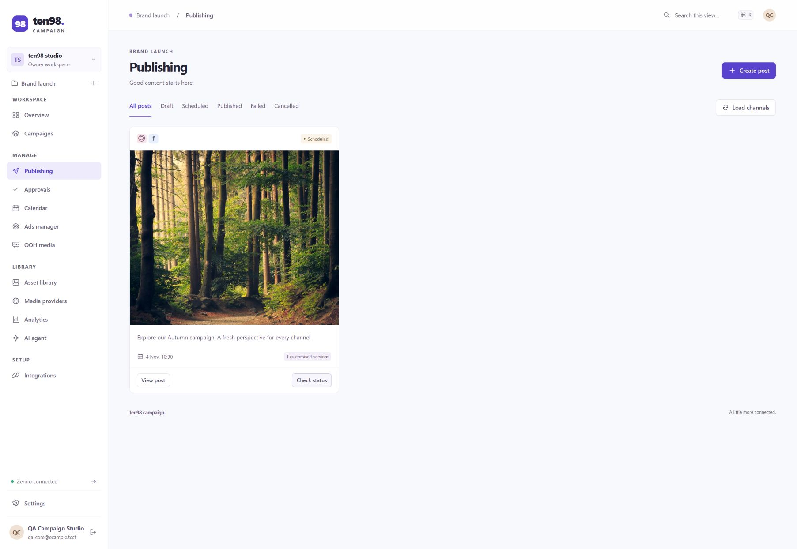
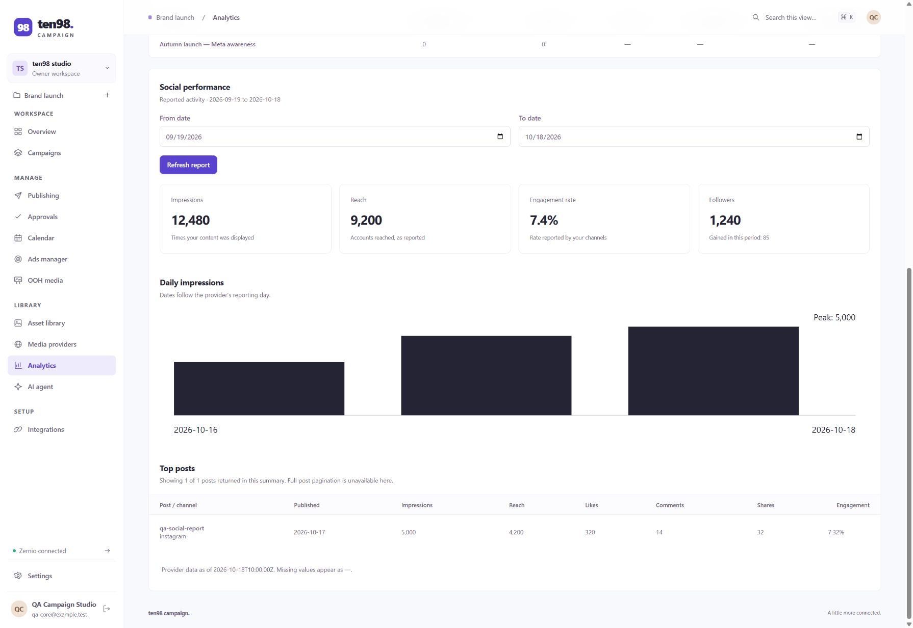
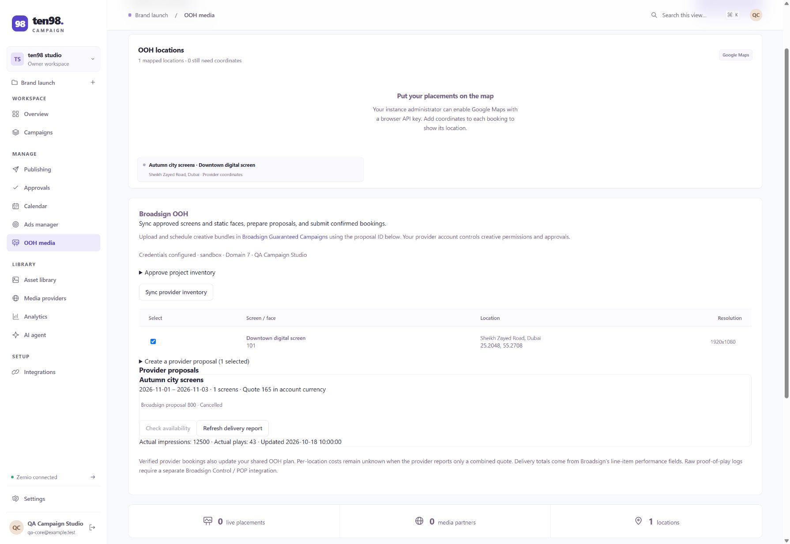
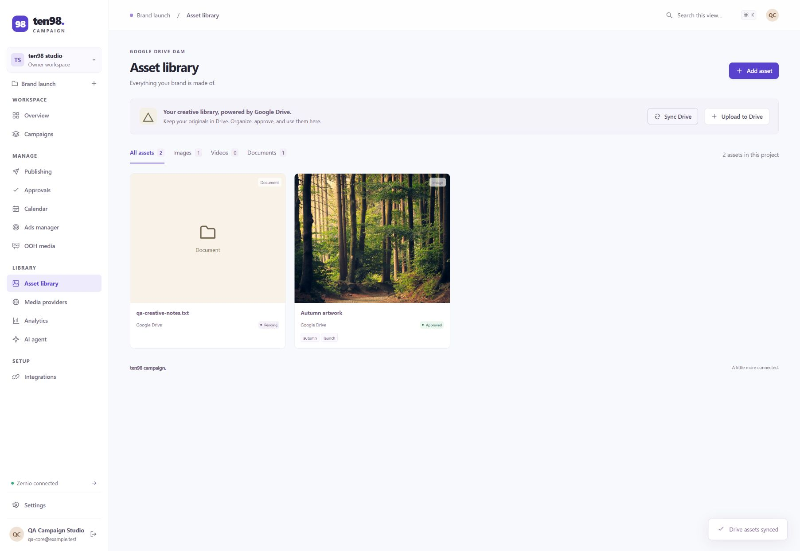

# End-to-end verification — v0.7.0

## Replies, short links and tracking

Verified on 18 October 2026 with the production frontend, an isolated local database, synthetic contacts and mocked providers. External provider requests were blocked except for the recorded mock contracts. No real SMS, WhatsApp or email was sent, and no DNS or TLS configuration was changed.

| Area | Result |
| --- | --- |
| SMS replies | Open replies from the selected campaign, read its verified incoming message, submit one reply from the original Twilio sender, and read back the queued receipt. |
| WhatsApp replies | Open the campaign's scoped account and incoming conversation, reply inside the service window, and read back the provider acknowledgement/history. |
| Short links | Save a branded HTTPS origin and website allowlist, create a campaign-associated URL with UTM parameters, and render its QR preview. Save shortened social and SMS drafts without publishing. |
| Campaign association | A new direct draft requires its first save before shortening. Browser save → shorten → save retained the campaign ID and the exact Wikipedia destination with balanced parentheses. |
| QR and tracking | Decode the actual HTTP SVG with an independent QR decoder; verify its exact URL and fixed redirect destination. Submit one ordinary visit, one QR-tagged visit, one pageview and one named event. Repeating the event ID counted once; the report showed each counter as one and omitted query strings/fragments. |
| Email reply routing | Native provider checks verify Cloudflare's configured `reply_to` field. Receiving and forwarding remain external Cloudflare Email Routing configuration. |

The full native suite passes **149** checks. The v0.7.0 production build and actual non-root Docker image smoke check pass; the production dependency audit reports no known vulnerabilities. Regression coverage includes signed incoming/status callbacks, durable instance-wide hashed SMS opt-outs across future projects, HTTP 400 Twilio opt-out receipts, duplicate/uncertain replies, original-sender attribution, contact imports, stale asynchronous editors and provider reconciliation, link permissions and immutability, redirect host/destination checks, tracking privacy signals, CORS, intake limits and SPA page changes.

Live provider acceptance still requires configured credentials, approved accounts and public HTTPS callbacks. The branded domain was fictional in QA: DNS, TLS and reverse-proxy routes must be provisioned by the operator. The domain-check challenge does not independently verify ownership. Tracking measures requests/events, not unique people or independently verified ad conversions. See [setup and limits](tracking.md) and [inbox setup](inbox.md).

The browser walkthroughs below were recorded in earlier releases with the same isolated-provider approach. Their native regressions also pass in this release.

## Unified inbox release

Verified on 18 October 2026 with the production frontend, an isolated local app, synthetic identities and mocked Zernio responses. No real private message, public comment or review response was sent.

| Area | Browser result |
| --- | --- |
| Messenger | Load only the project's connected page, open incoming history, send one private reply, mark read, archive and reopen; the reopened row returns to the active list. Account-specific character limits are visible. |
| Contacts | Signed incoming webhook creates Alex's contact; opening older incoming history creates Sam's contact. Repeated reads retain two identities. Both appear in Direct campaigns with Messenger source and no email/SMS/WhatsApp consent. |
| Comments | Open a scoped post/thread, send a public child reply, read it back, like a comment and read back the changed reaction. |
| Reviews | Load a Google Business review, add a public response, then explicitly approve replacing it and read the updated text back. |

The recorded mock requests confirm durable operation keys and exact scoped account/resource payloads. Native HTTP checks also cover signed replay/conflicts, contact atomicity, permissions and reply windows, attachments, duplicate/uncertain sends, deep comment replies, Meta ad routing, Instagram hidden-comment recovery, malformed provider data, stale review versions, permission changes during preflight, and project isolation. Live acceptance requires configured accounts, permissions and webhook subscriptions; see [inbox setup](inbox.md).

## Direct campaigns release

Verified on 18 October 2026 in an isolated local app with synthetic contacts, the production frontend and mocked providers. No real email, SMS, WhatsApp messages or voice calls were sent. The QA proxy supplied the fixed HTTPS app origin for callback/unsubscribe contract testing; production requires an actual public HTTPS address.

| Area | Browser result |
| --- | --- |
| Contacts | Preview/import a CSV with a repeated address, a disposable domain and an invalid address; merge the duplicate; show row errors, channel-specific consent and a disposable-domain flag. |
| Email | Create a transactional draft; personalize the eligible contact; exclude the disposable address; explicitly confirm the message purpose; submit to the Cloudflare mock; show its confirmed delivery receipt. Optional sandboxed HTML renders escaped personalization and blocks external content. |
| SMS | Save a future local-time schedule, restart the QA app and retain that schedule; create an immediate campaign with personalization, segment estimates and STOP footer; show two delivered mock receipts. |
| WhatsApp | Load the scoped account and approved template/language; fill template values; preview the exact text; explicitly submit a broadcast; refresh both recipient statuses to delivered. |

Native checks cover contact hygiene and consent evidence, CSV dry runs/deduplication, MX/null-MX/A/AAAA outcomes, durable destination suppression, email purpose and unsubscribe, exact provider payloads, approved WhatsApp media/button options, queue scheduling, in-flight cancellation, stale confirmations, lost acknowledgements/restart recovery, signed callbacks and opt-outs, stale delivery readback, and actual frontend handlers.

Real delivery remains dependent on configured credentials, account approval and provider access. Cloudflare permits transactional email only; queued email has no per-message delivery lookup, and suppression refresh is not an open/click report. DNS and disposable/typo heuristics do not prove that an individual mailbox exists. Voice campaigns remain excluded. See [direct campaign setup and limitations](direct-campaigns.md).

## Existing campaign workflows

Verified on 18 October 2026 with the production frontend, actual local HTTP server, isolated database and synthetic accounts. Provider mocks blocked external API calls and recorded requests. Existing user data and credentials were not used for tests.

## Five-area browser walkthrough

| Area | Verified workflow |
| --- | --- |
| Ads manager | Connected Meta/native account selection; create a paused image campaign; load campaign spend/impressions; scoped ad details; edit and read back a headline; pause an ad; rename an ad set and change its daily budget with provider confirmation. |
| Social publishing | Select Instagram/Facebook accounts; attach approved Drive-backed artwork and a campaign; separate Instagram caption/first comment; shared Facebook copy; effective previews and preflight; require approval, request review and approve; explicitly schedule at 10:30 Dubai time and verify `2026-11-04T06:30:00.000Z` in the provider request. |
| Analytics | Load the requested reporting window; verify impressions, reach, followers, engagement, daily chart and post metrics against the fixture. Missing local campaign metrics remain unknown; explicit zeros are preserved. |
| OOH | Approve domain/client/screen scope; sync inventory and coordinates; save a proposal; use the provider-calculated quote; check availability; explicitly approve booking; refresh exact line-item delivery totals; request cancellation, retain its pending state, then reconcile confirmed cancellation into the shared plan. |
| Drive DAM | Sync original links and thumbnails; upload a document; edit public delivery media, tags and description; approve artwork; repeat sync without duplicates; preserve unchanged approvals; reset approval when source metadata changes; reuse the asset and description/alt text in social publishing. Invalid provider metadata leaves assets unchanged. |

Read-only checks of the recorded requests and isolated database verified the same results, including one uploaded document, exact caption/options/alt-text payloads, UTC scheduling, approved review state, ad-set budget/name changes, and cancelled provider placements. No real ad activation, booking, upload or social publication occurred.

## Runnable checks

Run `npm run build` and `npm test`. Temporary HTTP servers/databases, provider mocks and actual frontend handlers cover authentication/OIDC, roles, invitations, encrypted integration settings, calendar/maps behavior, provider recovery, approvals, direct campaigns, the unified inbox and the five areas above.

The ads HTTP check creates 20 supported format combinations: Meta image/video/carousel, Google Search/Display/Performance Max and Demand Gen variants, LinkedIn image/video, TikTok video, Pinterest image, X cards, ChatGPT cards, and Reddit image/video/carousel/text. It also checks creative/status/budget changes, supported renames, partial-post boosts, malformed acknowledgements, date handling, isolation and connection races.

Drive checks cover concurrent imports, repeated IDs and pages, incomplete/malformed responses, atomic rollback, media metadata, preserved manual fields/approvals, GIF restrictions, alt text, uploads and uncertain acknowledgements. OOH checks include inclusive date limits, inventory normalization, idempotency, booking/delivery/cancellation, stale-report races and confirmed-write refresh recovery. Social checks cover per-platform persistence, immediate publishing/scheduling/updates/retries, all creative references, approval invalidation, creator permissions and stale UI recovery. Analytics checks cover inclusive reporting windows, numeric/null/zero values and foreign or malformed rows. Project-change checks prevent delayed uploads or old callbacks from starting writes in a former project.

## Fixes completed

- Ad lists enforce the selected campaign/network locally; successful copies of partially delivered social posts can be boosted after fresh account checks.
- Google advertising dates preserve the account's calendar date, including single-day campaigns. Unsupported renames and Smart+ creative edits fail before provider writes; Display creative editing is exposed.
- Create/boost and mutation acknowledgements validate identity, scope and confirmation. A failed details refresh after a confirmed write cannot encourage another edit until refreshed.
- Approval results and initial provider-status refreshes update the UI correctly. Missing local metrics no longer appear as fabricated zero values or invalid ratios.
- OOH screens use normalized IDs, date windows are inclusive, and stale reads cannot overwrite cancellation receipts. Confirmed actions with failed follow-up loading require an explicit refresh before further changes.
- Drive metadata is validated before atomic imports, deduplicated and retained for publishing restrictions. GIF and alt-text handling are consistent with the asset library.

## Live account acceptance

No real provider credentials were supplied for these tests. Live Zernio delivery, ad permissions/spend, Google Drive/Shared Drive access, Google Maps rendering with a billed/referrer-restricted key, public HTTPS webhooks, and Broadsign account behavior require acceptance with the operator's configured accounts. Google Maps coordinates and loader behavior were checked; a real Google map render was not claimed without a key. Provider-specific creative trafficking and unsupported native controls remain the documented dashboard workflows in the README.
